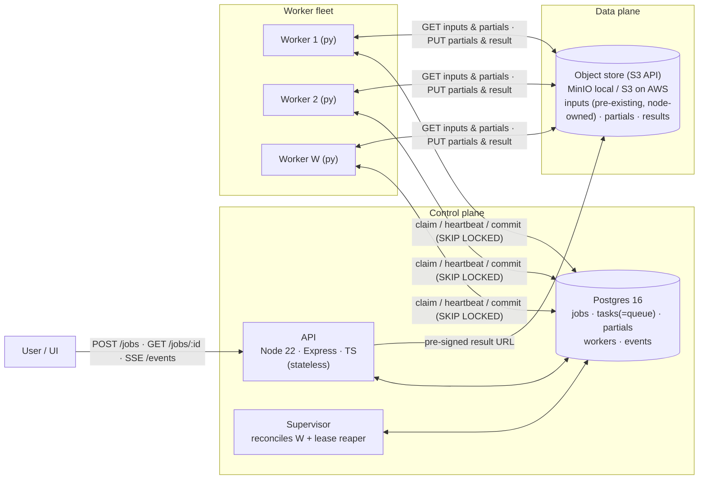
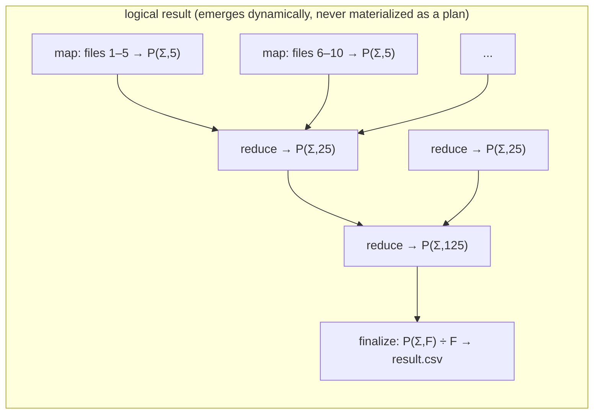
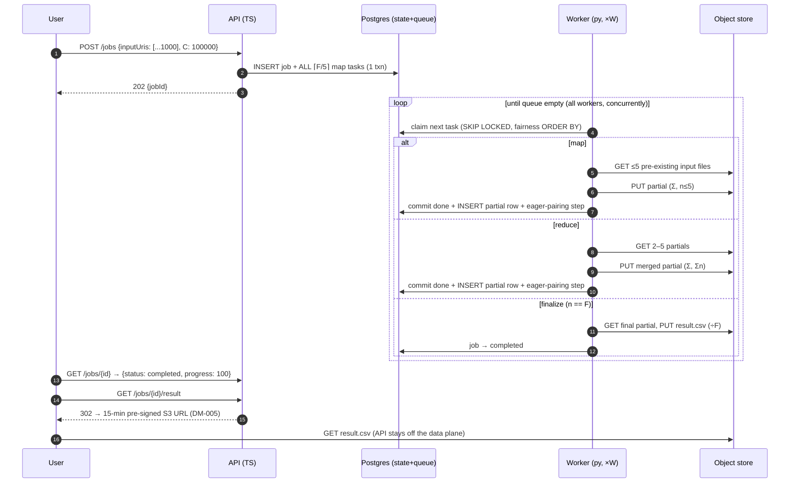
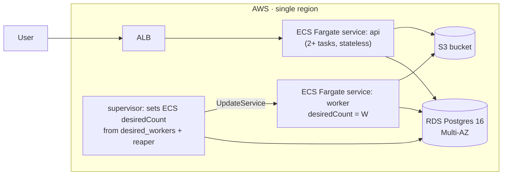

# Distributed Mean — High-Level Design

**Date:** 2026-08-10 · **Author:** Samkit Shah
**Reads with:** `01-requirements-and-assumptions.md` · decisions justified in `itds/DM-001…DM-011`

---

## 1. Design thesis

The job is a **distributed fold**: `mean_i = (Σ_f file_f[i]) / F`. Because sums are
associative and commutative, partial sums can be combined **in any order, in any
grouping, by any worker** — so the system never needs a barrier, a coordinator that
tracks the whole computation, or any notion of "which worker owns which piece."

The concrete setting is **federated-learning weight aggregation** (00 §Setting): the F
inputs are model-weight vectors that already exist on the nodes that trained them, so
the system ingests `inputUris[]` and never generates data.

Everything else follows from three commitments:

1. **Partials carry `(sum-vector, count)`, never means** (DM-001/DM-010). Combining is
   order-independent and exact; divide by F once at the end.
2. **A partial is file-shaped**, so the K=5 RAM constraint applies to reduction too →
   reduction is a recursive **5-ary tree** executed *through the same queue* as
   everything else (DM-001).
3. **Workers pull; the tree is never pre-built.** Reduce tasks are created *eagerly*
   whenever ≥K partials exist (or fewer, in drain mode) — so fast workers reduce
   while slow workers are still mapping, and no branch waits on a specific child
   (DM-002/DM-003).

In one sentence: *"I turn the job into a bag of idempotent tasks whose
partial results are closed under a 5-ary merge, let heterogeneous workers pull from
the bag, and completion is the theorem that a partial covering all F files is the
answer."*

### Why build this instead of Spark / Dask / Temporal?

Index-wise mean over F files is six lines of Spark (`treeAggregate`) or Dask, and
dynamic fan-out with durable children is Temporal's canonical demo. We build anyway,
for three reasons worth saying out loud: (1) the brief fixes the components — Node
API, DB, queue, Python workers — and evaluates the *distribution algorithm itself*;
hiding it inside someone else's scheduler forfeits the deliverable. (2) Spark's
driver/shuffle model assumes homogeneous, co-scheduled executors — the brief
explicitly withdraws that assumption — and Temporal would carry ~25k activity events
per job with the partial-consumption invariant living *outside* its transaction
boundary. (3) Nothing off-the-shelf can join DM-004's single transaction that consumes
partials and enqueues their reducer. If this were production and the constraints were
absent, Spark `treeAggregate` is the answer and we'd say so.

## 2. Architecture



**Separation of planes** is the load-bearing property: the control plane moves
kilobytes (task rows, URIs); the data plane moves ≈1.2 TB of **traffic** at the max job
(800 GB of input **reads** + ~400 GB intermediates) against ≈200 GB **resident** that we
own at peak (partials + result — the 800 GB of inputs is the nodes' storage, not ours),
per 01 §4 — traffic is the request/transfer bill, residency is the storage-days bill.
Postgres never sees a vector; S3 never sees a state machine.

| Component | Responsibilities | Deliberately NOT responsible for |
|---|---|---|
| API (Node/Express/TS) | validate & create jobs; validate `inputUris[]` against the allow-list; enqueue all map tasks in the submit transaction; serve status/result/SSE; write `desired_workers` | any computation; holding job state in memory (stateless → scalable, restart-safe); creating input data |
| Postgres | source of truth: job/task/partial state; **the queue** (SKIP LOCKED); fairness ordering; events | carrying data-plane bytes |
| Object store | pre-existing input vectors (node-owned, read-only to us), partial vectors, result files | consistency of the computation (control plane owns that) |
| Workers (Python) | claim task → execute (map/reduce/finalize) → commit + eager-pairing step | choosing what to work on (the claim query decides), tracking siblings |
| Supervisor | reconcile actual worker count → `desired_workers`; requeue expired leases (reaper) | scheduling decisions |
| UI | render SSE stream: workers free/busy, jobs queued/running/done, per-job progress | anything write-path except W and job submission |

## 3. The task model

Three task types, one queue, uniform claiming (full schemas in LLD):

| Type | Reads | Writes | Fan |
|---|---|---|---|
| `map` | ≤5 pre-existing input files | 1 partial `(Σ, n≤5)` | ⌈F/5⌉ tasks, all created in the submit transaction |
| `reduce` | 2–5 partials | 1 partial `(Σ, Σn)` | created dynamically |
| `finalize` | 1 partial with n=F | result file (÷F) | exactly 1 |

### Eager 5-ary reduction (the centerpiece)

There is **no pre-built tree**. When any worker commits a task, in the *same
transaction* — serialised per job by an advisory lock, so concurrent committers can
never both undercount the partial set and both decline (LLD §4) — it
runs the pairing step. The reaper runs the same step, under the same lock, for every job
whose task it requeues, because a reaped task never commits and would otherwise leave the
job with no future trigger. Those two are the complete trigger set:

```
≥ 5 unconsumed partials for job?         → claim 5, insert reduce task
else: job has no pending/running tasks
      and ≥ 2 partials?                  → claim them (2–4), insert reduce  (drain mode)
else: exactly 1 partial and n == F?      → CAS job running→finalizing, insert finalize
```



Why eager beats a fixed tree: a fixed tree makes reduce node X wait for its *specific*
5 children — one slow child stalls the branch even though 50 other partials are ready.
Eager pairing merges *whatever is ready*, so a straggler's output is simply picked up
by whichever merge happens next. Stragglers delay only their own ~8 MB of work, never
a branch (DM-002).

**Completion is a two-part predicate, neither part a counter** (DM-003): a *data
proof* — counts are conserved (map and reduce both preserve total covered files, and T1
created a map task for every one of the F inputs), so `n == F` on a lone unconsumed
partial cannot be true early or missed late — plus a *liveness predicate* (no
pending/claimed tasks for the job) that rules out a partial set which merely *looks*
complete while map or reduce work is still queued or in flight. The second half is a
task-state read, not a mutable counter, so redelivery cannot corrupt it. Progress
counters exist only to feed the UI.

## 4. Job lifecycle (happy path)



Failure path in one line (details DM-006): every claim carries a **lease**; a crashed
worker's lease expires, the reaper flips the task back to `pending`, and because every
task writes to a **deterministic object key**, the retry overwrites harmlessly.
At-least-once delivery + idempotent effects ≡ effectively-once outcome.

## 5. How each critical aspect is answered

| Brief's criterion | Design answer |
|---|---|
| F > 5, no 1:1 job↔queue-item | Job explodes into ⌈F/5⌉ map tasks at submit plus dynamically created reduce tasks on one queue (§3). |
| Efficient distribution | Pull-based claiming (self-balancing under heterogeneous speeds) + adaptive fan-in + priority `finalize>reduce>map` (DM-002, DM-007). |
| Deciding "job finished" | Conservation invariant: lone partial with n=F is the result — proof, not heuristic (DM-003). |
| Multiple concurrent jobs | Fair claim ordering: least-in-flight job first → round-robin effect, no starvation (DM-007). |
| Worker idle time | A worker idles only when *zero* eligible tasks exist system-wide; eager reduction keeps work flowing during the map phase; drain-mode fan-in shortens the tail. |

## 6. AWS deployment story

Same containers, same code; adapters (`BlobStore`, queue is Postgres in both) make
this a config change, not a rewrite.



- **W via API** becomes `ecs.updateService(desiredCount)` — the supervisor's reconcile
  loop is unchanged in shape (DM-008).
- RDS Multi-AZ gives control-plane HA; S3 gives 11-nines data durability; workers and
  API are cattle.
- **Deliberately NOT SQS** — the eager-pairing step needs `{consume partials +
  create reduce task}` to be atomic; in Postgres that's one transaction, with SQS it's
  a dual-write requiring an outbox. At ~25k tasks/job and I/O-bound tasks, claim rate
  is «1k/s — far inside Postgres territory. The switch trigger (>5k tasks/s sustained,
  cross-service consumers) and the outbox migration are specified in DM-004.

## 7. Failure modes

| Failure | Detection | Recovery | Data at risk |
|---|---|---|---|
| Worker crash mid-task | lease expiry (reaper) | task → pending, re-claimed | none (idempotent keys) |
| Worker crash after PUT, before commit | lease expiry | retry overwrites same key | none |
| Duplicate execution (redelivery) | — | consumed-guard blocks double-consume of partials; PUTs idempotent | none |
| Executor raises (bad file, blob error past its retries) | the exception itself | worker requeues its own task, fenced by its lease token (LLD §4 T4); requeue *is* the retry | none |
| Input URI unreachable, missing, or of the wrong length | blob GET past its bounded retries, or the C-length check at read | T4 requeue; three attempts then `dead` → job `failed` with the offending URI in `last_error`. A length mismatch is permanent — retrying cannot fix it — and still costs its three attempts | none (inputs are read-only) |
| Poison task (bug, corrupt file) | attempts ≥ 3 | task → dead, job → failed with cause — except a `finalize` on a job still holding its count=F partial, which raises `job.needs_finalize` instead of discarding a finished computation | job fails loudly, others unaffected |
| Reaper/supervisor down | health check | leases expire later; W drifts — degraded, not broken | none |
| Postgres down | connection errors | system pauses; workers back off; no partial state lost (A-6) | none |
| Object store down | GET/PUT errors past the client's bounded retries | task-level requeue (T4), then dead → job failed with cause | none |
| API down | ALB health | stateless → restart; jobs in flight unaffected (workers don't need API) | none |

## 8. What breaks first at 10× (evolution ladder)

1. **F → 1M**: tasks/job ≈ 250k — still fine in Postgres (indexed, «1k/s claims).
2. **Task rate > ~5k/s sustained** (many huge concurrent jobs, sub-second tasks):
   move queue to SQS + outbox (DM-004 failure condition). State stays in Postgres.
3. **C → 100M** (0.8 GB per vector): partials stop fitting the K×8 MB budget → chunk
   the C dimension *within* a task (stream in column blocks); topology unchanged.
4. **Workers → beyond W_max=32**: at 2 connections per worker (LLD §5) the pool is `2W + 10`,
   so Postgres connection pressure arrives first → PgBouncer, then the SQS move.
5. **Multi-tenant / quotas**: fairness ordering generalizes to weighted fair queuing
   (DM-007 evolution).

## 9. Security & ops notes (current scope)

No authn/authz (A-4) — which makes `PATCH /system/workers` an unauthenticated
fleet-wide control in the current scope; acceptable at this scope, named here so it's a
choice. Secrets via env/SSM; S3 bucket private with IAM task roles; pre-signed result
URLs expire in 15 minutes. **SSRF posture — this is where the setting adds real attack
surface:** `inputUris[]` is user-supplied, so an unguarded fetcher would be an SSRF
primitive pointed at anything the worker's network can reach. Two asymmetric guards, one
per direction: **writes** are system-generated from `jobs/{jobId}/…` templates only and
the `BlobStore` rejects any key outside the job prefix; **reads** are permitted only for
URIs whose bucket/host appears in `INPUT_URI_ALLOWLIST` (LLD §8), rejected at submit by
the API and again at read by the worker, so a URI that passes validation and is later
re-pointed still cannot escape the allow-list. The local supervisor mounts
`/var/run/docker.sock` — root-equivalent on the host, demo-only; on AWS it is an
IAM-scoped `ecs:UpdateService` call, never a socket. Inputs are model weights, not
personal data, but they are *someone else's* objects: we read them and never mutate
them. Metrics/events in the `events` table; logs to stdout → CloudWatch.

## 10. Document map

| Doc | Content |
|---|---|
| `01-requirements-and-assumptions.md` | FR/NFR, assumptions A-1…A-10, envelope, service-time model |
| `03-lld.md` | schema DDL, claim SQL, transactions, worker loop, API spec, formats, runbook |
| `04-decision-journey.md` | the decision index: question → chosen answer → alternatives, tiered Scope → Bare minimum → MVP → Optimizations → Edge cases |
| `itds/DM-001…DM-011` | one decision record per load-bearing choice |
