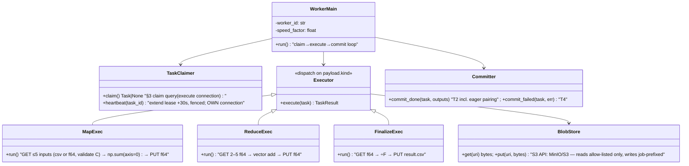

# Distributed Mean — Low-Level Design

**Date:** 2026-08-10 · **Author:** Samkit Shah
**Reads with:** `02-hld.md` (architecture & rationale) · ITDs for decisions

---

## 1. Database schema (Postgres 16)

```sql
CREATE TYPE job_status  AS ENUM ('pending','running','finalizing','completed','failed');
-- 'finalizing' guards double-finalize: the completion branch of T2 transitions
-- running → finalizing atomically with enqueuing the finalize task (DM-003).
CREATE TYPE task_status AS ENUM ('pending','claimed','done','dead');
-- There is no transient 'failed' task state: a retryable failure IS a requeue to
-- 'pending' (T4), so failure and redelivery share one code path (DM-006).
CREATE TYPE task_type   AS ENUM ('map','reduce','finalize');
-- Three types. Inputs pre-exist at node-owned URIs (00 §Setting, 01 A-2), so there is
-- no generation task and no task type that creates data.

CREATE TABLE jobs (
  id            UUID PRIMARY KEY DEFAULT gen_random_uuid(),
  f             INT  NOT NULL CHECK (f BETWEEN 2 AND 99999),
  c             INT  NOT NULL CHECK (c BETWEEN 2 AND 999999),
  status        job_status NOT NULL DEFAULT 'pending',
  idempotency_key TEXT,                        -- from the POST /jobs header; NULL allowed
  result_uri    TEXT,
  error         TEXT,
  created_at    TIMESTAMPTZ NOT NULL DEFAULT now(),
  completed_at  TIMESTAMPTZ
);
CREATE UNIQUE INDEX idx_jobs_idem ON jobs (idempotency_key)
  WHERE idempotency_key IS NOT NULL;           -- partial: absent header ⇒ distinct job

CREATE TABLE tasks (
  id            UUID PRIMARY KEY DEFAULT gen_random_uuid(),
  job_id        UUID NOT NULL REFERENCES jobs(id),
  type          task_type   NOT NULL,
  status        task_status NOT NULL DEFAULT 'pending',
  priority      SMALLINT    NOT NULL,          -- finalize=0 < reduce=1 < map=2
  CHECK (priority = CASE type WHEN 'finalize' THEN 0 WHEN 'reduce' THEN 1
                              WHEN 'map'      THEN 2 END),
                                               -- makes the ASC/DESC footgun unrepresentable:
                                               -- priority is a function of type, not a free field.
                                               -- The CASE is exhaustive over task_type, so a new
                                               -- type cannot be inserted without pricing it
  payload       JSONB       NOT NULL,          -- see §2 (URIs + params only, < 1 KB)
  attempts      SMALLINT    NOT NULL DEFAULT 0,
  max_attempts  SMALLINT    NOT NULL DEFAULT 3,  -- finalize rows are seeded with 10 (§4 T3)
  worker_id     TEXT,
  lease_token   UUID,                          -- per-claim fencing token (DM-006)
  claimed_at    TIMESTAMPTZ,                   -- set by the claim query from the DB's now()
  deadline_at   TIMESTAMPTZ,                   -- claimed_at + TASK_DEADLINE_SECONDS (§8);
                                               -- absolute, never extended by a heartbeat
  lease_expires_at TIMESTAMPTZ,
  last_error    TEXT,                          -- last executor exception, recorded by T4;
                                               -- carries the offending input URI when a
                                               -- map task dies on an unreadable input
                                               -- There is no dedupe_key column: no task type
                                               -- spawns another, so no natural key is needed.
                                               -- map tasks are created exactly once, inside
                                               -- T1's single transaction; reduce dedupe comes
                                               -- from the consumed-guard, finalize's from the
                                               -- running→finalizing CAS (DM-006)
  created_at    TIMESTAMPTZ NOT NULL DEFAULT now(),
  finished_at   TIMESTAMPTZ
);
-- The queue index: everything the claim query touches, nothing else.
CREATE INDEX idx_tasks_claim ON tasks (status, priority, created_at) WHERE status = 'pending';
CREATE INDEX idx_tasks_lease ON tasks (lease_expires_at) WHERE status = 'claimed';
CREATE INDEX idx_tasks_inflight ON tasks (job_id) WHERE status = 'claimed';  -- the inflight CTE
CREATE INDEX idx_tasks_job   ON tasks (job_id, status);

CREATE TABLE partials (
  id            UUID PRIMARY KEY DEFAULT gen_random_uuid(),
  job_id        UUID NOT NULL REFERENCES jobs(id),
  uri           TEXT NOT NULL,                 -- s3://…/partials/{producing_task_id}.f64
  count         INT  NOT NULL,                 -- n: input files covered by this Σ-vector
  produced_by   UUID NOT NULL UNIQUE REFERENCES tasks(id),  -- + ON CONFLICT DO NOTHING:
                                                            -- a redelivered task cannot
                                                            -- insert its partial twice (DM-006)
  consumed_by   UUID REFERENCES tasks(id),     -- NULL = available for pairing
  created_at    TIMESTAMPTZ NOT NULL DEFAULT now()
);
CREATE INDEX idx_partials_avail ON partials (job_id) WHERE consumed_by IS NULL;

CREATE TABLE workers (
  id             TEXT PRIMARY KEY,             -- hostname:pid
  status         TEXT NOT NULL DEFAULT 'idle', -- idle | busy | draining
  current_task   UUID,
  speed_factor   REAL NOT NULL DEFAULT 1.0,    -- demo: artificial slowdown for straggler tests
  last_heartbeat TIMESTAMPTZ NOT NULL DEFAULT now(),
  started_at     TIMESTAMPTZ NOT NULL DEFAULT now()
);

CREATE TABLE system_config (
  key TEXT PRIMARY KEY, value JSONB NOT NULL   -- {'desired_workers': 8}
);

CREATE TABLE events (                          -- append-only, feeds SSE (DM-009)
  id BIGSERIAL PRIMARY KEY,                    -- SSE Last-Event-ID cursor. Ids are ASSIGNED
                                               -- monotonically but COMMIT order is not id
                                               -- order: a slow txn's lower id becomes visible
                                               -- after a fast txn's higher id. So the SSE
                                               -- ticker reads with a visibility lag —
                                               -- `WHERE id > $cursor AND ts < now() - interval
                                               -- '1 second'` — and that lag IS the resume
                                               -- guarantee (DM-009). Rolled-back inserts leave
                                               -- permanent id gaps; gaps are normal.
  ts TIMESTAMPTZ NOT NULL DEFAULT now(),
  type TEXT NOT NULL,                          -- taxonomy in DM-009 (job.* streamed; task.* folded into 1 Hz snapshot)
  job_id UUID, task_id UUID, worker_id TEXT,
  payload JSONB NOT NULL DEFAULT '{}'
);
CREATE INDEX ON events (id) INCLUDE (type);
CREATE INDEX ON events (job_id, id);
CREATE INDEX ON events (ts) WHERE type = 'task.done';   -- the 10 s throughput gauge (DM-009):
                                               -- the (id) index cannot serve a ts predicate
-- Retention: trim to 7 days / 2M rows; no UPDATE/DELETE otherwise.
```

Invariants (enforced by transactions in §4):

- **INV-1 (conservation):** for a running job, Σ count over unconsumed partials + files covered by in-flight/pending map & reduce tasks = F.
- **INV-2:** a partial is consumed by at most one task, ever (`consumed_by` set once, guarded).
- **INV-3:** a job is `completed` iff a result object exists and exactly one partial with count = F was finalized.

## 2. Task payloads (discriminated union — TS type, mirrored by Python dataclasses)

```ts
type TaskPayload =
  | { kind: 'map';      jobId: string; inputUris: string[] /* ≤5 */; c: number }
  | { kind: 'reduce';   jobId: string; partialIds: string[] /* 2–5 */; partialUris: string[]; c: number }
  | { kind: 'finalize'; jobId: string; partialUri: string; f: number; c: number };
```

**A map task's `inputUris` *are* its identity**, which is why no `dedupe_key` exists. The
URIs are user-supplied at submit and are not derivable from any template of ours — the input
objects live on the nodes that produced them (01 A-2), under whatever keys those nodes chose.
T1 slices the submitted `inputUris[]` into ⌈F/5⌉ contiguous `K_FANIN`-sized chunks **in list
order** and writes one map row per chunk inside its single transaction (§4 T1), so the
mapping from submitted list to map tasks is total, disjoint, and created exactly once: a
transaction either commits every map row or none. There is no spawn path, hence no duplicate
map task to dedupe and no natural key to compute (DM-006).

Every URI a worker reads is checked against `INPUT_URI_ALLOWLIST` (§8) — at submit by the API
and again at read by the worker's `BlobStore`, because the object behind a URI can change
between the two. Reading also validates C: byte length must equal `c × 8` for a `.f64` object,
or the line count must equal `c` for a `.csv` one (§7). A mismatch is a permanent error, not a
transient one — it still travels T4's normal path and consumes its three attempts, because
retrying costs seconds and special-casing permanence costs a branch.

## 3. The claim query (queue + fairness in one statement)

```sql
WITH inflight AS (                                   -- fresh per claim: one aggregate,
  SELECT job_id, count(*) AS n                       -- never a per-row correlated subquery
  FROM tasks WHERE status='claimed' GROUP BY job_id
),
candidate AS (
  SELECT t.id
  FROM tasks t
  JOIN jobs j ON j.id = t.job_id
             AND j.status IN ('running','finalizing')  -- 'finalizing' included: the
                                                       -- finalize task itself must be
                                                       -- claimable or no job completes
  LEFT JOIN inflight i ON i.job_id = t.job_id
  WHERE t.status = 'pending'
  ORDER BY
    COALESCE(i.n, 0),                                -- fairness: least-served job first
    t.priority ASC,                                  -- finalize=0 first … map=2 last
    t.created_at                                     -- FIFO tiebreak
  LIMIT 16                                           -- ≈ceil(W_max/2): see the note below
  FOR UPDATE OF t SKIP LOCKED
)
UPDATE tasks t SET status='claimed', worker_id=$1, attempts=attempts+1,
                 lease_token = gen_random_uuid(),
                 claimed_at  = now(),
                 lease_expires_at = now() + interval '30 seconds',
                 deadline_at = now() + make_interval(secs => $2)   -- absolute ceiling (§8):
                                                                   -- TASK_DEADLINE_SECONDS,
                                                                   -- flat across all three types
WHERE t.id = (SELECT id FROM candidate LIMIT 1)       -- one task per claim, still
RETURNING t.id, t.type, t.payload, t.lease_token, t.deadline_at;
```

**All lease and deadline arithmetic uses the DB's `now()`; workers never send timestamps.**
`claimed_at`, `deadline_at`, and `lease_expires_at` are written by the statements above and by
the heartbeat below, all server-side, so worker clock skew cannot lengthen a lease or move a
deadline. The only worker-supplied number is `$2` — the `TASK_DEADLINE_SECONDS` config
constant (§8), not a clock reading. The ceiling is flat because all three surviving types do
comparable work (§8); should a heavier type ever be added, this expression becomes a
`CASE t.type …` reading the ceiling off the row's own type rather than the caller's guess —
a config-shaped change, not a redesign (DM-006).

Notes:
- All transactions run at **READ COMMITTED** (Postgres default) — deliberate: every
  guard in T2/T3 is a *conditional write* (`WHERE consumed_by IS NULL`,
  `WHERE lease_token=$mine AND status='claimed'`, `ON CONFLICT DO NOTHING`), which takes
  its row lock at write time; nothing relies on snapshot stability, so no serialization
  retries exist to handle.
- `SKIP LOCKED` gives W concurrent claimers W distinct rows — this *is* the queue
  (DM-004). **Why the CTE takes 16 rows and not 1:** `LIMIT 1` makes every idle claimer
  compute the *same* single winner, so at W workers one wins and W−1 get zero rows and
  sleep `IDLE_POLL_MS` with work still pending — an idle-time bug in the exact system
  whose thesis is minimal idling. `LIMIT 16` (≈`ceil(W_max/2)`, W_max=32 per DM-008) locks
  a window instead of a point; `SKIP LOCKED` hands each claimer a different surviving row,
  and the UPDATE's `LIMIT 1` keeps the one-task-per-claim contract. A claimer only sleeps
  when all 16 head candidates are contended, which needs >16 simultaneous claims against a
  queue that short.
- The `inflight` CTE computes per-job counts once per claim (DM-007's own form) — a
  correlated-subquery-in-ORDER-BY form would evaluate it once per pending row (up to
  20k rows) and could not use `idx_tasks_claim`. It reads `idx_tasks_inflight`.
- Lease = 30 s, heartbeat extends every 10 s, reaper polls every 5 s → worst-case
  crash-detection latency 35 s. Short lease is safe *because* heartbeats extend it.
  Heartbeat SQL is itself fenced — by token AND status, since a token the reaper
  hasn't rotated would otherwise still match:
  `UPDATE tasks SET lease_expires_at = now() + interval '30 seconds'
   WHERE id=$t AND lease_token=$mine AND status='claimed'
     AND lease_expires_at < deadline_at`
  — every term is a column or the DB's `now()`; the worker sends only its task id and
  token. The deadline conjunct means a wedged-but-heartbeating worker (hung blob GET
  behind a live heartbeat thread) cannot push its lease past the `deadline_at` stamped at
  claim time (DM-006).

## 4. The four critical transactions

### T1 — job submission (API)

```
-- Pre-transaction validation (zod at the edge, §6):
--   inputUris is a non-empty array; F := inputUris.length, 2 ≤ F ≤ 99999
--   every URI parses and its bucket/host is in INPUT_URI_ALLOWLIST → else 422
--   no duplicate URIs (a repeated URI would double-weight that vector) → else 422
--   reject 413 if F×C×8 > MAX_JOB_BYTES; 429 + Retry-After if active ≥ MAX_ACTIVE_JOBS

BEGIN;
  INSERT INTO jobs (f, c, idempotency_key) VALUES ($f, $c, $key)
    ON CONFLICT (idempotency_key) DO NOTHING
    RETURNING id;                                    -- a retried POST returns the
                                                     -- original job, never a twin
  IF 0 rows:                                         -- the key already exists
    SELECT id FROM jobs WHERE idempotency_key=$key;   -- the original
    COMMIT; return 200 {jobId}                        -- no new tasks, no new events

  -- ALL map tasks, now: slice inputUris into ⌈F/K_FANIN⌉ contiguous chunks in LIST ORDER
  INSERT INTO tasks (job_id, type, priority, payload)
    VALUES ($jobId, 'map', 2,
            {kind:'map', jobId: $jobId, c: $c, inputUris: <chunk>})   -- one row per chunk
    …;                                               -- ⌈F/5⌉ rows: 200 at F=1000,
                                                     -- 20,000 at the max job
  UPDATE jobs SET status='running' WHERE id=$jobId;
  INSERT INTO events (type, job_id, payload) VALUES ('job.submitted', …);
COMMIT;
```

**The whole map frontier is created here, in one transaction, and nowhere else.** That is
affordable precisely because the inputs already exist: their URIs are known at submit, so the
partition of the F inputs into ⌈F/5⌉ chunks is a pure function of the submitted list and needs
no observation of anything that has run. 20,000 rows at the max job is a single bulk `INSERT`
of < 20 MB of JSONB — milliseconds, against a job that will take hours of worker time. Two
consequences worth naming: **there is no dynamic map spawn anywhere in the system** (which is
why §1 has no `dedupe_key` — a transaction commits every map row or none, so a duplicate map
task is unrepresentable, DM-006), and **INV-1 holds from the first commit**: every one of the
F inputs is covered by exactly one map task before any worker claims anything.

Transactional enqueue: job row and its map tasks are atomic — no half-submitted jobs
(DM-004). `jobs.idempotency_key` is nullable and uniquely indexed only where non-null
(§1), so without the header duplicate submission creates a distinct job by design, since the
URI list carries no identity of its own. The 0-row path must *select* the original id, not
infer it: the conflicting row was written by an earlier request whose id this one never saw.

### T2 — task completion + eager pairing (worker; the heart of the system)

Runs after the worker has PUT its output object. All-or-nothing:

```
BEGIN;
  UPDATE tasks SET status='done', finished_at=now()
    WHERE id=$taskId AND status='claimed' AND lease_token=$myToken;  -- fenced commit (DM-006)
  -- 0 rows → lease was reaped & task reassigned (zombie worker) → ROLLBACK, discard.
  -- The PUT already done is harmless: deterministic key, byte-identical content.

  -- No branch inserts a map task: T1 created every one of them (§4 T1). This transaction
  -- only ever ADDS a partial and, from it, at most one reduce or finalize task.

  IF task.type IN ('map','reduce'):
    INSERT INTO partials (job_id, uri, count, produced_by) VALUES (…)
      ON CONFLICT (produced_by) DO NOTHING;          -- idempotent metadata

    -- EAGER PAIRING (DM-003) runs UNCONDITIONALLY here — see below — serialised per job:
    SELECT pg_advisory_xact_lock(hashtext('pairing'), hashtext($jobId::text));
    -- Why a lock and not SKIP LOCKED on partials: under READ COMMITTED two
    -- concurrent T2s could each undercount the partial set AND each see the other's
    -- task as still 'claimed' — both decline to pair, and with pairing triggered only
    -- by a commit, the job would strand its last partials forever (reachable at
    -- F=7, W=2). The advisory lock serialises the section (milliseconds); the
    -- second pairer sees the first's committed partial and its task row as 'done'.
    -- Two-key form: the 'pairing' namespace keeps these locks from colliding with any
    -- other advisory-lock use, and the int4 key space means the worst a hash collision
    -- can do is serialise two unrelated jobs' pairing steps (throughput, not safety).

    IF job.status <> 'running' → skip pairing        -- a cancelled or terminal job creates
                                                     -- no new reduce work (§6's designed
                                                     -- 'cancelled' status stops the tree
                                                     -- growing, not just the claiming); the
                                                     -- finalize enqueue below is the CAS
                                                     -- anyway, so this is belt-and-braces

    SELECT id, uri, count FROM partials
      WHERE job_id=$jobId AND consumed_by IS NULL
      ORDER BY created_at
      FOR UPDATE;                                    -- plain lock; we hold the job lock

    IF ≥ 5 rows                            → take the oldest 5
    ELIF no pending/claimed tasks for job
         AND ≥ 2 rows                      → take all (2–4)     -- drain mode
    ELIF exactly 1 row AND count == F      → CAS: UPDATE jobs SET status='finalizing'
                                                  WHERE id=$jobId AND status='running';
                                             1 row → INSERT finalize task
                                                     (max_attempts=10, see T3)
                                             0 rows → someone finalized already: no-op
    ELSE                                   → nothing IF some task for this job is still
                                             pending/claimed (a later commit pairs it).
                                             IF pending+claimed == 0 the invariant is
                                             broken — 1 partial with count<F and no work
                                             left — so assert and alert rather than
                                             silently no-op:
                                             INSERT INTO events (type, job_id, payload)
                                               VALUES ('job.stranded',
                                                       $jobId, {partials:[{id,count}…]});

    IF took k rows:
      new_reduce_id = INSERT INTO tasks (type='reduce', priority=1, payload={partialIds, partialUris});
      UPDATE partials SET consumed_by = new_reduce_id WHERE id IN (…);  -- INV-2

  IF task.type = 'finalize':
    UPDATE jobs SET status='completed', result_uri=$uri, completed_at=now()
      WHERE id=$jobId AND status='finalizing';       -- fenced job-state CAS
COMMIT;
```

**Pairing runs on every successful fenced commit, not only when the partial INSERT
returned a row.** The tempting shortcut — "`ON CONFLICT DO NOTHING` matched, so a prior
commit of this task already paired; skip" — reopens the stranding hole from the other side.
A task that was reaped after inserting its partial but before its commit landed will be
retried; its second commit sees the conflict, skips pairing, and no further pairing trigger
for that job exists, so the job ends holding unconsumed partials forever. The partial
INSERT's idempotency protects the *row*; it says nothing about whether the *decision* has
been made. Pairing is itself idempotent under the job lock — it reads current state and
either takes rows or does not — so running it twice costs one indexed read, and skipping it
once costs the job. Hence: fenced update succeeds ⇒ pairing runs.

Concurrent committers for the *same job* queue on the advisory lock for milliseconds;
committers for different jobs don't interact (the lock is per-job). The trigger set for
pairing is therefore exactly: **T2 after every successful fenced commit, and T3 for every
job whose task it touches** — which together leave no state in which a job has unconsumed
partials and no future pairing evaluation.

### T3 — reaper (supervisor, every 5 s)

```
requeued = UPDATE tasks
      SET status = CASE WHEN attempts >= max_attempts THEN 'dead' ELSE 'pending' END,
          worker_id = NULL, lease_expires_at = NULL, claimed_at = NULL,
          lease_token = NULL          -- rotate the fence on requeue so a stale
                                      -- token can never match a future state
 WHERE status='claimed'
   AND (lease_expires_at < now()
        OR now() > deadline_at)       -- absolute deadline, stamped at claim time (§3):
                                      -- reclaims wedged-but-heartbeating holders,
                                      -- including a map task hung on an unreachable
                                      -- input URI (DM-006)
 RETURNING id, job_id, status;
-- attempts is incremented at CLAIM time only (T-claim); the CASE above reads the
-- already-incremented value. Incrementing here too would double-count.

-- T3 ALSO PAIRS. For each DISTINCT job_id in `requeued`, in its own transaction (the lock
-- is xact-scoped, so one job's pairing must not hold the next one's), run the identical
-- pairing step under the identical lock:
FOR EACH job_id IN requeued:
  BEGIN;
    SELECT pg_advisory_xact_lock(hashtext('pairing'), hashtext(job_id::text));
    <the pairing step of T2, verbatim>
  COMMIT;
-- Why: T2's pairing only fires on a *successful* commit, and a reaped task never
-- commits. Without this, the sequence {task inserts its partial → is reaped → retried
-- attempt's fenced commit matches 0 rows or dies too} leaves a job with unconsumed
-- partials and no future trigger. Pairing is idempotent under the lock, so running it
-- from the reaper is free when nothing needs pairing and load-bearing when something
-- does. Together with T2 this closes the trigger set: every transition that can change
-- a job's pairing eligibility is followed by a pairing evaluation.

UPDATE jobs SET status='failed', error='task exhausted retries: …'
 WHERE id IN (SELECT DISTINCT job_id FROM tasks WHERE status='dead')
   AND status IN ('running','finalizing')      -- status guard: without it this statement
                                               -- rewrites already-failed jobs every 5 s
                                               -- forever and can clobber a job that
                                               -- completed after its dead task
   AND NOT EXISTS (                            -- and never bury a finished computation:
     SELECT 1 FROM partials p
      WHERE p.job_id = jobs.id AND p.consumed_by IS NULL AND p.count = jobs.f);
-- The excluded case gets an event instead — the answer exists, only the divide is left:
INSERT INTO events (type, job_id, payload)
  SELECT 'job.needs_finalize', id, '{}' FROM jobs
   WHERE status IN ('running','finalizing')
     AND EXISTS (SELECT 1 FROM tasks t WHERE t.job_id=jobs.id AND t.status='dead')
     AND EXISTS (SELECT 1 FROM partials p WHERE p.job_id=jobs.id
                   AND p.consumed_by IS NULL AND p.count = jobs.f);

-- Backstop sweep (DM-003): jobs in ('running','finalizing') with zero pending/claimed
-- tasks. If found: log loudly; if a count==F partial exists, reset the job to
-- 'finalizing' and re-enqueue finalize. T3's own pairing step above makes this state
-- unreachable, so the sweep is redundant-but-retained instrumentation — a cheap
-- independent check on the pairing trigger set, not a mechanism the design relies on.
```

**Why `finalize` gets `max_attempts = 10`.** Every other task type can be re-derived from
its inputs, so exhausting 3 attempts loses seconds of work. A `finalize` that dies on its
third attempt strands a *completed computation*: the `count == F` partial exists, the whole
job's work is in it, and flipping the job to `failed` is irreversible — the claim query
serves only `('running','finalizing')`, so a re-enqueued finalize task on a `failed` job can
never be claimed. The task itself is one idempotent 8 MB read, a divide, and a PUT, so ten
attempts cost ~20 s of worst-case retry against hours of discarded work. Belt and braces:
the `NOT EXISTS` guard above refuses to fail such a job at all, and the backstop can reset
it to `finalizing` and re-enqueue.

### T4 — executor failure (worker)

An exception inside `execute()` — a blob GET that raised after its bounded retries, an input
URI that is missing or holds the wrong number of values, a bug — is not a lost lease and must
not wait for one. The worker requeues its own task, fenced identically to T2:

```
UPDATE tasks
   SET status = CASE WHEN attempts >= max_attempts THEN 'dead' ELSE 'pending' END,
       worker_id = NULL, lease_token = NULL, lease_expires_at = NULL,
       claimed_at = NULL, last_error = $err
 WHERE id=$taskId AND lease_token=$myToken AND status='claimed';
-- 0 rows → we were already reaped; the reaper's requeue stands. Discard and move on.
```

**Requeue *is* the retry** — there is no transient `failed` state to pass through and no
backoff timer, which is why `task_status` has no `'failed'` value (§1). The claim query's
fairness ordering supplies the spacing a backoff would: a requeued task re-enters at the
back of its job's FIFO tiebreak, and its job's `inflight` count no longer includes it, so
another job's work is served in between. Recording `last_error` on the row keeps the cause
attached to the thing that failed rather than in a log line nobody correlates — and it is the
one place an operator learns *which* input URI was unreadable, so the message includes the URI
verbatim and, on a length mismatch, both the declared C and the length found. A task that
reaches `attempts >= max_attempts` here goes straight to `dead` and is picked up by T3's
job-failure statement on its next pass — with T3's guards, so a `dead` finalize on a job
that still holds its `count == F` partial raises `job.needs_finalize` instead of failing it.

## 5. Worker (Python) — structure & loop



```python
def run(self):
    register_worker(self.worker_id)
    while not self.shutdown_requested:          # SIGTERM → drain: finish task, then exit
        task = claimer.claim()                   # one round-trip; None if queue empty
        if task is None:
            idle_sleep(0.5 + jitter())           # bounded poll; LISTEN/NOTIFY evolution noted
            continue
        set_worker(busy, task.id)
        try:
            with heartbeat_every(10, task.id):   # covers EXECUTE ONLY — see below
                outputs = executor.execute(task) # pure compute + blob I/O, NO db writes
            # heartbeat thread has stopped here; the execute connection is now idle
            committer.commit_done(task, outputs) # T2: single multi-statement transaction
        except Exception as err:
            committer.commit_failed(task, err)   # T4: fenced requeue-or-dead
        set_worker(idle)
```

**Two Postgres connections per worker, and the heartbeat stops before T2 begins.** The
`with heartbeat_every(...)` block wraps `execute` and *not* the commit, for a reason that is
easy to get wrong: T2 is a multi-statement transaction, and libpq connections are not
thread-safe for concurrent use, so a heartbeat firing on the same connection mid-T2 would
interleave a statement into an open transaction — silently making the heartbeat part of T2
(rolled back with it) at best, and corrupting the protocol stream at worst. So the heartbeat
lives on its own dedicated connection (that is why there are two), and it also *exits* before
T2 opens: once execution is done there is nothing left to keep a lease alive for, and a
heartbeat racing a fenced commit can only extend a lease the commit is about to retire. Pool
sizing follows from this: `2W` worker connections plus the API's pool (§8).

**`MapExec` and the two guards on `BlobStore`.** A map task's inputs are objects we do not own,
named by URIs the user supplied, so `BlobStore.get` is the trust boundary: it refuses any URI
whose bucket/host is not in `INPUT_URI_ALLOWLIST` (§8) — re-checked here and not only at submit,
because the API's check and the read are separated in time — and it applies the bounded
connect/read timeouts of §8 so an unreachable node fails the task instead of hanging it.
`MapExec` then sniffs the format by extension (`.f64` → `np.frombuffer`, `.csv` → one value per
line) and **validates C before adding anything**: `len(bytes) == c × 8` for `.f64`, line count
`== c` for `.csv`. A mismatch raises, which is T4's path — the retry cannot succeed, but it
costs seconds and buys a uniform failure route. `BlobStore.put` is guarded in the other
direction: writes are rejected outside `jobs/{jobId}/`, so nothing we compute can land on a
node's input keys.

Execution discipline that makes everything else true:
- **Execute is side-effect-free except deterministic PUTs.** Output keys are
  deterministic functions of the task's *inputs*: partials at
  `jobs/{jobId}/partials/{taskId}.f64` (task-derived), the result at
  `jobs/{jobId}/result.csv` (job-derived — safe because exactly one finalize exists
  per job, guarded by the running→finalizing CAS, with identical input partial and F).
  Any retry writes the same bytes to the same key (idempotency, DM-006).
- **Memory ceiling respected by construction:** map/reduce hold ≤5 × C float64
  (~40 MB at C=1M) + one accumulator (`np.add` in place, 8 MB).
- **Straggler simulation for the demo:** `SPEED_FACTOR` env inserts
  `sleep(work_time × (factor−1))` — lets us demo NFR-2 with 1×/3×/10× workers.

## 6. API surface (Express + TS)

| Method & path | Req | Resp | Notes |
|---|---|---|---|
| `POST /jobs` | `{inputUris, c}` + `Idempotency-Key?` header | `202 {jobId}` \| `413` too large \| `422` bad/duplicate/non-allow-listed URI \| `429` too many active | T1. **`inputUris[]` is the job**: F = its length, and T1 chunks it in list order into every `map` task. Each URI is validated against `INPUT_URI_ALLOWLIST` at submit and again at read (§5) |
| `GET /jobs` | `?limit=50&cursor=` | `[{id,f,c,status,progress,…}]` | keyset pagination on `(created_at,id)` |
| `GET /jobs/:id` | — | `{status, progress, counts:{pending,claimed,done}, error?}` | progress = coverage (below) |
| `GET /jobs/:id/result` | — | `302` → 15-min pre-signed GET \| `?inline=1` streams \| `409` until `completed` | keeps the API off the data plane (DM-005 owns this decision) |
| `GET /system/stats` | — | `{workers:{desired,alive,busy,idle}, jobs:{queued,running,completed,failed}, tasks:{…}, throughput, oldest_pending_age_sec, oldest_claimed_age_sec}` | UI poll fallback; the two age gauges are the stall SLIs (DM-009) |
| `PATCH /system/workers` | `{desired}` | `200 {desired}` | bonus: writes `system_config`; supervisor reconciles (DM-008) |
| `GET /events` | SSE | `text/event-stream` | tails `events` table (`id > Last-Event-ID AND ts < now() - interval '1 second'` — the visibility lag is the resume guarantee, §1) (DM-009) |

**API conventions:** request validation with zod at the edge, mirroring the DDL
CHECKs; error bodies `{error:{code,message,details}}`; `400` malformed / `422`
out-of-range or an input URI that is unparseable, duplicated, or outside
`INPUT_URI_ALLOWLIST` (the `details` field names the offending URI) / `409`
result-not-ready / `413` job too large (`F×C×8 > MAX_JOB_BYTES`) / `429` too many active
jobs (with `Retry-After`). Note what is deliberately *not* validated at submit: whether
each object exists and holds C values. That would be F HEADs — 100k round-trips on the
submit path, exactly the serialization the design refuses — so existence and length are
checked at read, where the failure has a retry path and an owner (§5, T4). Completion is discovered via the
`job.completed` SSE event or polling `GET /jobs/:id`; webhooks are out of scope (no
authenticated caller to sign to). "Jobs queued" (bonus metric) = running jobs with ≥1
pending task and 0 in flight. Cancellation is out of scope but designed:
`UPDATE jobs SET status='cancelled'` — the claim query already filters on job status,
so in-flight tasks drain and nothing new is claimed.

**Progress metric (DM-009):**
`(mapped_files + reduce_inputs_consumed) / (F + R_est)`, clamped at 99% until
`finalize` commits (only finalize writes 100%). `mapped_files` = Σ count over
map-produced partials; `reduce_inputs_consumed` = partials with `consumed_by IS NOT
NULL`; `R_est` = ideal-tree input count ≈ F/4, computed at submit. Both numerator terms
are monotone (state-derived, not event-counted, so retries can't double-count).
`done_tasks/total_tasks` is rejected: eager pairing grows the denominator mid-run and
the bar would move backwards.

## 7. Object store layout & file formats

**Inputs are external.** They live on the nodes that produced them, under keys those nodes
chose, and are never under `jobs/{jobId}/`. We hold their URIs, read them, and write nothing
back:

```
INPUT (external, node-owned, read-only, allow-listed)
  s3://<node-bucket>/<whatever-the-node-chose>.f64   # raw little-endian float64 × C
  s3://<node-bucket>/<whatever-the-node-chose>.csv   # one value per line, C lines

OUR bucket: distributed-mean
  jobs/{jobId}/partials/{taskId}.f64         # raw little-endian float64 × C; metadata: x-amz-meta-count
  jobs/{jobId}/result.csv                    # one float per line, C lines
```

- **Input format is not ours to choose — only what we accept is.** Both `.f64` (raw
  little-endian float64) and `.csv` (one value per line) are read, sniffed by extension, and
  validated against the declared C at read (byte length `= C×8`, or line count `= C`). Nothing
  else is accepted; an unknown extension fails the task like any other bad input (§5, DM-005).
- `.f64` partials: 8 MB vs ~20 MB CSV; `np.frombuffer` / Node `DataView` read it with
  zero parsing (DM-005). `count` lives in the partials row (authoritative) and object
  metadata (debug). Result stays CSV — human-readable, mirroring the brief's example.
- GC: on job completion, `partials/` is deleted async (config-gated so the demo can keep it
  for inspection). Inputs are **never** GC'd — they are not ours. The same pass deletes the
  job's `partials` rows — including the root partial, whose `consumed_by` stays NULL forever
  because `finalize` reads it rather than consuming it into another partial. It is the one row
  the `idx_partials_avail` index would otherwise accumulate per completed job.

## 8. Configuration

| Var | Default | Meaning |
|---|---|---|
| `K_FANIN` | 5 | the RAM constraint; single source of truth. Also the chunk size T1 slices `inputUris[]` by |
| `INPUT_URI_ALLOWLIST` | (demo: the MinIO host) | buckets/hosts a worker may READ inputs from. User-supplied URIs are checked against it at submit and again at read; writes are independently confined to `jobs/{jobId}/` (§5, HLD §9) |
| `LEASE_SECONDS` / `HEARTBEAT_SECONDS` / `REAPER_SECONDS` | 30 / 10 / 5 | liveness; worst-case crash detection 35 s (DM-006) |
| `TASK_DEADLINE_SECONDS` | 300 | absolute per-task ceiling, stamped as `deadline_at` at claim time — heartbeats can't extend past it; reclaims wedged-but-heartbeating workers (DM-006). **Flat, because the three types now do comparable work:** the heaviest is a `map` moving ~108 MB (~2.2 s), so 300 s is ~135× headroom and still ~13× on a 10× straggler. The claim query reads the ceiling from config, not from the row's type, so per-type ceilings return as a `CASE` the day a heavier type is added (§3, DM-006) |
| DB connections per worker | 2 | one for claim/execute/commit (T2 is a multi-statement txn), one dedicated to the heartbeat thread (libpq is not thread-safe per connection) — §5 |
| DB pool sizing | `2W + API pool (10)` | at W_max=32: 74 connections; past that, PgBouncer (DM-004) |
| `MAX_JOB_BYTES` / `MAX_ACTIVE_JOBS` | 50 GB local (5 GB demo) / 8 | admission control; unset on AWS |
| blob client timeouts | connect 5 s, read 30 s, ≤3 retries | a hung GET fails instead of hanging the task |
| `MAX_ATTEMPTS` | 3 (`finalize`: 10) | then task dead → job failed (T4/T3). `finalize` is exempted because failing it discards a completed computation, and the task is one idempotent read + divide (§4 T3) |
| `IDLE_POLL_MS` | 500 | worker poll when queue empty |
| `SPEED_FACTOR` | 1.0 | per-worker artificial slowdown (demo) |
| `DESIRED_WORKERS` seed | 4 | initial W; runtime value in `system_config` |

## 9. Local demo topology (docker-compose)

```
services:
  postgres:16    minio    api (node:22)    supervisor (node:22, same image)
  worker:        build: ./worker (python:3.12-slim + numpy)
                 deploy: replicas = W   (supervisor scales via docker API)
  ui:            static site served by api (or nginx)  — SSE client
```

**Runbook:** `make up` (compose up + node-pg-migrate applied by the API on boot + `mc mb` init
container creates our bucket) · `make seed F=1000 C=100000` (**harness, not a system feature**:
writes F fixture weight vectors into a MinIO bucket standing in for the nodes' storage, then
prints their URIs) · `make demo F=1000 C=100000` (seeds if needed, then `POST /jobs` with those
`inputUris` — **264 tasks: 200 map + 63 reduce + 1 finalize ≈ 580 worker-seconds ≈ 2.4 min at
W=4**, per the service-time model in 01 §4) · `make chaos` (demo + kill a busy worker) ·
`make test`. The seeder writes to a bucket that is *in* `INPUT_URI_ALLOWLIST` and *not* the
bucket our workers write to, so the demo exercises the real read/write asymmetry rather than
a self-owned shortcut. Why Postgres and not SQLite for a laptop demo: SQLite has no
`SKIP LOCKED`, a single writer, no `LISTEN/NOTIFY`, and RDS is the deployment target —
the demo must exercise the same concurrency the design argues about.

## 10. Test & demo plan (maps to §6 success criteria of 01-requirements)

1. **Correctness:** `pytest` — `test_prompt_example` is now simply *the main path*: F=2, C=3,
   `inputUris` pointing at two fixture files holding [1,2,3] and [4,5,6] → asserts exactly
   [2.5, 3.5, 4.5]. Golden test: F=7, C=10 vs numpy reference (exercises F%5≠0 → drain-mode
   fan-in 2); mixed-format test: the same job with half the inputs `.csv` and half `.f64`
   returns the identical vector; property test: F,C ≤ 100 over random fixture vectors vs
   reference, 1e-9 rel.
2. **Unit:** eager-pairing under concurrent committers with the interleaving *pinned*:
   two explicit DB connections, a `pg_sleep` injected between one committer's partial
   INSERT and its pairing step, asserting the other blocks on the advisory lock and
   then sees the full partial set (INV-1/INV-2 hold; the mutual-decline race is
   unreachable).
3. **Chaos demo:** `docker kill` a busy worker → lease expires → task re-claimed →
   job completes; result still exact (idempotent PUT). Sharpened variant for the T3
   pairing trigger: kill the worker *after* its partial INSERT would have landed, so the
   retry's commit hits `ON CONFLICT` — assert the job still pairs and completes, and that
   the backstop sweep never fires.
4. **Straggler demo:** 3 workers at SPEED_FACTOR 1/3/10; assert fast worker's task
   count ≈ proportional, total idle time ≈ 0 while eligible tasks exist.
5. **Fairness demo:** submit F=5000 job, then F=8 job 5 s later → F=8 completes far
   earlier (claim-order round-robin), both progress concurrently in UI.
6. **Bad-input tests:** (a) an `inputUris` entry outside `INPUT_URI_ALLOWLIST` → `422` at
   submit, no job row, no tasks; (b) an allow-listed URI whose object does not exist → the map
   task retries three times and goes `dead`, the job goes `failed`, and `last_error` names that
   URI; (c) an object of the wrong length → same path, `last_error` reports declared C vs
   length found; (d) a duplicated URI in the list → `422` (it would double-weight one vector).
