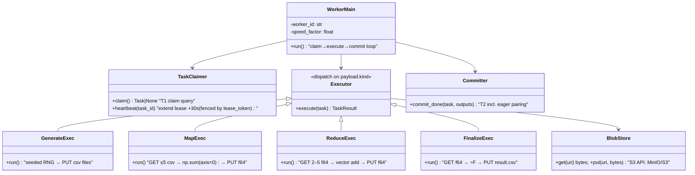

# Distributed Mean — Low-Level Design (v1)

**Date:** 2026-08-09 · **Author:** Samkit Shah · **Status:** v1 (iterating)
**Reads with:** `02-hld.md` (architecture & rationale) · ITDs for decisions

---

## 1. Database schema (Postgres 16)

```sql
CREATE TYPE job_status  AS ENUM ('pending','running','finalizing','completed','failed');
-- 'finalizing' guards double-finalize: the completion branch of T2 transitions
-- running → finalizing atomically with enqueuing the finalize task (DM-003).
CREATE TYPE task_status AS ENUM ('pending','claimed','done','failed','dead');
CREATE TYPE task_type   AS ENUM ('generate','map','reduce','finalize');

CREATE TABLE jobs (
  id            UUID PRIMARY KEY DEFAULT gen_random_uuid(),
  f             INT  NOT NULL CHECK (f BETWEEN 2 AND 99999),
  c             INT  NOT NULL CHECK (c BETWEEN 2 AND 999999),
  status        job_status NOT NULL DEFAULT 'pending',
  result_uri    TEXT,
  error         TEXT,
  created_at    TIMESTAMPTZ NOT NULL DEFAULT now(),
  completed_at  TIMESTAMPTZ
);

CREATE TABLE tasks (
  id            UUID PRIMARY KEY DEFAULT gen_random_uuid(),
  job_id        UUID NOT NULL REFERENCES jobs(id),
  type          task_type   NOT NULL,
  status        task_status NOT NULL DEFAULT 'pending',
  priority      SMALLINT    NOT NULL,          -- finalize=0 < reduce=1 < map=2 < generate=3
  payload       JSONB       NOT NULL,          -- see §2 (URIs + params only, < 1 KB)
  attempts      SMALLINT    NOT NULL DEFAULT 0,
  max_attempts  SMALLINT    NOT NULL DEFAULT 3,
  worker_id     TEXT,
  lease_token   UUID,                          -- per-claim fencing token (DM-006)
  lease_expires_at TIMESTAMPTZ,
  dedupe_key    TEXT,                          -- natural key for tasks spawned by other
                                               -- tasks, e.g. 'map:{jobId}:{batchIdx}' —
                                               -- re-run parents can't fork duplicate subtrees
  created_at    TIMESTAMPTZ NOT NULL DEFAULT now(),
  finished_at   TIMESTAMPTZ
);
-- The queue index: everything the claim query touches, nothing else.
CREATE INDEX idx_tasks_claim ON tasks (status, priority, created_at) WHERE status = 'pending';
CREATE INDEX idx_tasks_lease ON tasks (lease_expires_at) WHERE status = 'claimed';
CREATE INDEX idx_tasks_job   ON tasks (job_id, status);
CREATE UNIQUE INDEX idx_tasks_dedupe ON tasks (dedupe_key) WHERE dedupe_key IS NOT NULL;

CREATE TABLE partials (
  id            UUID PRIMARY KEY DEFAULT gen_random_uuid(),
  job_id        UUID NOT NULL REFERENCES jobs(id),
  uri           TEXT NOT NULL,                 -- s3://…/partials/{producing_task_id}.f64
  count         INT  NOT NULL,                 -- n: input files covered by this Σ-vector
  produced_by   UUID NOT NULL UNIQUE REFERENCES tasks(id),  -- + ON CONFLICT DO NOTHING:
                                                            -- a redelivered task cannot
                                                            -- insert its partial twice (DM-006)
  consumed_by   UUID REFERENCES tasks(id),     -- NULL = available for pairing
  created_at    TIMESTAMPTZ NOT NULL DEFAULT now()
);
CREATE INDEX idx_partials_avail ON partials (job_id) WHERE consumed_by IS NULL;

CREATE TABLE workers (
  id             TEXT PRIMARY KEY,             -- hostname:pid
  status         TEXT NOT NULL DEFAULT 'idle', -- idle | busy | draining
  current_task   UUID,
  speed_factor   REAL NOT NULL DEFAULT 1.0,    -- demo: artificial slowdown for straggler tests
  last_heartbeat TIMESTAMPTZ NOT NULL DEFAULT now(),
  started_at     TIMESTAMPTZ NOT NULL DEFAULT now()
);

CREATE TABLE system_config (
  key TEXT PRIMARY KEY, value JSONB NOT NULL   -- {'desired_workers': 8}
);

CREATE TABLE events (                          -- append-only, feeds SSE (DM-009)
  id BIGSERIAL PRIMARY KEY,                    -- monotone; doubles as SSE Last-Event-ID cursor
  ts TIMESTAMPTZ NOT NULL DEFAULT now(),
  type TEXT NOT NULL,                          -- taxonomy in DM-009 (job.* streamed; task.* folded into 1 Hz snapshot)
  job_id UUID, task_id UUID, worker_id TEXT,
  payload JSONB NOT NULL DEFAULT '{}'
);
CREATE INDEX ON events (id) INCLUDE (type);
CREATE INDEX ON events (job_id, id);
-- Retention: trim to 7 days / 2M rows; no UPDATE/DELETE otherwise.
```

Invariants (enforced by transactions in §4):

- **INV-1 (conservation):** for a running job, Σ count over unconsumed partials + files covered by in-flight/pending map & reduce tasks = F.
- **INV-2:** a partial is consumed by at most one task, ever (`consumed_by` set once, guarded).
- **INV-3:** a job is `completed` iff a result object exists and exactly one partial with count = F was finalized.

## 2. Task payloads (discriminated union — TS type, mirrored by Python dataclasses)

```ts
type TaskPayload =
  | { kind: 'generate'; jobId: string; fileIdxFrom: number; fileIdxTo: number; c: number; seedBase: string }
  | { kind: 'map';      jobId: string; inputUris: string[] /* ≤5 */; c: number }
  | { kind: 'reduce';   jobId: string; partialIds: string[] /* 2–5 */; partialUris: string[]; c: number }
  | { kind: 'finalize'; jobId: string; partialUri: string; f: number; c: number };
```

## 3. The claim query (queue + fairness in one statement)

```sql
WITH candidate AS (
  SELECT t.id
  FROM tasks t
  JOIN jobs j ON j.id = t.job_id AND j.status = 'running'
  WHERE t.status = 'pending'
  ORDER BY
    (SELECT count(*) FROM tasks x                    -- fairness: least-served job first
       WHERE x.job_id = t.job_id AND x.status = 'claimed'),
    t.priority,                                      -- finalize > reduce > map > generate
    t.created_at                                     -- FIFO tiebreak
  LIMIT 1
  FOR UPDATE OF t SKIP LOCKED
)
UPDATE tasks SET status='claimed', worker_id=$1, attempts=attempts+1,
                 lease_token = gen_random_uuid(),
                 lease_expires_at = now() + interval '30 seconds'
WHERE id = (SELECT id FROM candidate)
RETURNING id, type, payload, lease_token;
```

Notes:
- `SKIP LOCKED` makes W concurrent claimers contention-free (each skips rows another
  transaction holds) — this *is* the queue (DM-004).
- The fairness subquery is O(in-flight) via `idx_tasks_job`; at our scale (≤ hundreds
  in flight) it's noise. Evolution: materialize per-job in-flight counts if W ≫ 10³ (DM-007).
- Lease = 30 s, heartbeat extends every 10 s, reaper polls every 5 s → worst-case
  crash-detection latency 35 s. Short lease is safe *because* heartbeats extend it;
  the fencing `lease_token` (new per claim) makes zombie commits harmless (DM-006).

## 4. The three critical transactions

### T1 — job submission (API)

```
BEGIN;
  INSERT INTO jobs (f, c) VALUES ($f, $c) RETURNING id;
  -- seed generate tasks in batches of GEN_BATCH=50 files
  INSERT INTO tasks (job_id, type, priority, payload) SELECT … ;  -- ⌈F/50⌉ rows
  UPDATE jobs SET status='running' WHERE id=$jobId;
  INSERT INTO events (kind, job_id, data) VALUES ('job.created', …);
COMMIT;
```

Transactional enqueue: job row and its seed tasks are atomic — no half-submitted jobs (DM-004).

### T2 — task completion + eager pairing (worker; the heart of the system)

Runs after the worker has PUT its output object. All-or-nothing:

```
BEGIN;
  UPDATE tasks SET status='done', finished_at=now()
    WHERE id=$taskId AND status='claimed' AND lease_token=$myToken;  -- fenced commit (DM-006)
  -- 0 rows → lease was reaped & task reassigned (zombie worker) → ROLLBACK, discard.
  -- The PUT already done is harmless: deterministic key, byte-identical content.

  IF task.type IN ('map','reduce'):
    INSERT INTO partials (job_id, uri, count, produced_by) VALUES (…)
      ON CONFLICT (produced_by) DO NOTHING;                          -- idempotent metadata

    -- EAGER PAIRING (DM-003): claim ready siblings atomically
    SELECT id, uri, count FROM partials
      WHERE job_id=$jobId AND consumed_by IS NULL
      FOR UPDATE SKIP LOCKED;                                   -- lock-free vs concurrent pairers

    IF ≥ 5 rows                            → take 5
    ELIF no pending/claimed tasks for job
         AND ≥ 2 rows                      → take all (2–4)     -- drain mode
    ELIF exactly 1 row AND count == F      → INSERT finalize task
    ELSE                                   → nothing (partial waits)

    IF took k rows:
      new_reduce_id = INSERT INTO tasks (type='reduce', priority=1, payload={partialIds, partialUris});
      UPDATE partials SET consumed_by = new_reduce_id WHERE id IN (…);  -- INV-2
COMMIT;
```

Two workers finishing simultaneously both run T2; `SKIP LOCKED` on partials means they
grab disjoint sets — worst case two reduce tasks of fan-in <5 instead of one of 5:
slightly suboptimal, never incorrect.

### T3 — reaper (supervisor, every 5 s)

```
UPDATE tasks SET status = CASE WHEN attempts >= max_attempts THEN 'dead' ELSE 'pending' END,
               worker_id = NULL, lease_expires_at = NULL
 WHERE status='claimed' AND lease_expires_at < now();
UPDATE jobs SET status='failed', error='task exhausted retries: …'
 WHERE id IN (SELECT DISTINCT job_id FROM tasks WHERE status='dead');

-- Backstop sweep (DM-003): jobs 'running' with zero pending/claimed tasks should not
-- exist (the invariant says T2 always fires completion). If found: log loudly; if a
-- count==F partial exists, enqueue finalize. This is a bug detector, not a mechanism.
```

## 5. Worker (Python) — structure & loop



```python
def run(self):
    register_worker(self.worker_id)
    while not self.shutdown_requested:          # SIGTERM → drain: finish task, then exit
        task = claimer.claim()                   # one round-trip; None if queue empty
        if task is None:
            idle_sleep(0.5 + jitter())           # bounded poll; LISTEN/NOTIFY evolution noted
            continue
        set_worker(busy, task.id)
        with heartbeat_every(10, task.id):       # background lease extension
            outputs = executor.execute(task)     # pure compute + blob I/O, NO db writes
            committer.commit_done(task, outputs) # T2: single transaction
        set_worker(idle)
```

Execution discipline that makes everything else true:
- **Execute is side-effect-free except deterministic PUTs.** Output key =
  `jobs/{jobId}/partials/{taskId}.f64` — derived from the *task id*, so any retry of
  the same task writes the same key (idempotency, DM-006).
- **Memory ceiling respected by construction:** map/reduce hold ≤5 × C float64
  (~40 MB at C=1M) + one accumulator (`np.add` in place, 8 MB).
- **Straggler simulation for the demo:** `SPEED_FACTOR` env inserts
  `sleep(work_time × (factor−1))` — lets us demo NFR-2 with 1×/3×/10× workers.

## 6. API surface (Express + TS)

| Method & path | Req | Resp | Notes |
|---|---|---|---|
| `POST /jobs` | `{f, c}` | `202 {jobId}` | validates bounds; T1 |
| `GET /jobs` | — | `[{id,f,c,status,progress,…}]` | list, newest first |
| `GET /jobs/:id` | — | `{status, progress, counts:{pending,claimed,done}, error?}` | progress = covered/F (see below) |
| `GET /jobs/:id/result` | — | `200 text/csv` (stream) \| `409` if not done | API streams from blob store |
| `GET /system/stats` | — | `{workers:{desired,alive,busy,idle}, jobs:{queued,running,completed,failed}, tasks:{…}, throughput}` | UI poll fallback |
| `PATCH /system/workers` | `{desired}` | `200 {desired}` | bonus: writes `system_config`; supervisor reconciles (DM-008) |
| `GET /events` | SSE | `text/event-stream` | tails `events` table (id > Last-Event-ID) (DM-009) |

**Progress metric (DM-009):**
`(mapped_files + reduce_inputs_consumed) / (F + R_est)`, clamped at 99% until
`finalize` commits (only finalize writes 100%). `mapped_files` = Σ count over
map-produced partials; `reduce_inputs_consumed` = partials with `consumed_by IS NOT
NULL`; `R_est` = ideal-tree input count ≈ F/4, computed at submit. Both numerator terms
are monotone (state-derived, not event-counted, so retries can't double-count).
`done_tasks/total_tasks` is rejected: eager pairing grows the denominator mid-run and
the bar would move backwards.

## 7. Object store layout & file formats

```
bucket: distributed-mean
  jobs/{jobId}/inputs/{fileIdx}.csv          # one float per line ("0.7391824…\n")
  jobs/{jobId}/partials/{taskId}.f64         # raw little-endian float64 × C; metadata: x-amz-meta-count
  jobs/{jobId}/result.csv                    # one float per line, C lines
```

- CSV inputs: human-readable, satisfies "format of your choice", demo-friendly.
- `.f64` partials: 8 MB vs ~20 MB CSV; `np.frombuffer` / Node `DataView` read it with
  zero parsing (DM-005). `count` lives in the partials row (authoritative) and object
  metadata (debug).
- GC: on job completion, `inputs/` and `partials/` deleted async (config-gated so the
  demo can keep them for inspection).

## 8. Configuration

| Var | Default | Meaning |
|---|---|---|
| `K_FANIN` | 5 | the RAM constraint; single source of truth |
| `GEN_BATCH` | 50 | files per generate task |
| `LEASE_SECONDS` / `HEARTBEAT_SECONDS` / `REAPER_SECONDS` | 30 / 10 / 5 | liveness; worst-case crash detection 35 s (DM-006) |
| `MAX_ATTEMPTS` | 3 | then task dead → job failed |
| `IDLE_POLL_MS` | 500 | worker poll when queue empty |
| `SPEED_FACTOR` | 1.0 | per-worker artificial slowdown (demo) |
| `DESIRED_WORKERS` seed | 4 | initial W; runtime value in `system_config` |

## 9. Local demo topology (docker-compose)

```
services:
  postgres:16    minio    api (node:22)    supervisor (node:22, same image)
  worker:        build: ./worker (python:3.12-slim + numpy)
                 deploy: replicas = W   (supervisor scales via docker API)
  ui:            static site served by api (or nginx)  — SSE client
```

## 10. Test & demo plan (maps to §6 success criteria of 01-requirements)

1. **Correctness:** `pytest` — golden test: F=7,C=10 vs numpy reference (exercises
   F%5≠0 → drain-mode fan-in 2); property test: random F,C ≤ 100 vs reference, 1e-9 rel.
2. **Unit:** eager-pairing transaction under concurrent committers (two threads, assert
   disjoint consumption, INV-1/INV-2 hold).
3. **Chaos demo:** `docker kill` a busy worker → lease expires → task re-claimed →
   job completes; result still exact (idempotent PUT).
4. **Straggler demo:** 3 workers at SPEED_FACTOR 1/3/10; assert fast worker's task
   count ≈ proportional, total idle time ≈ 0 while eligible tasks exist.
5. **Fairness demo:** submit F=5000 job, then F=8 job 5 s later → F=8 completes far
   earlier (claim-order round-robin), both progress concurrently in UI.
```
