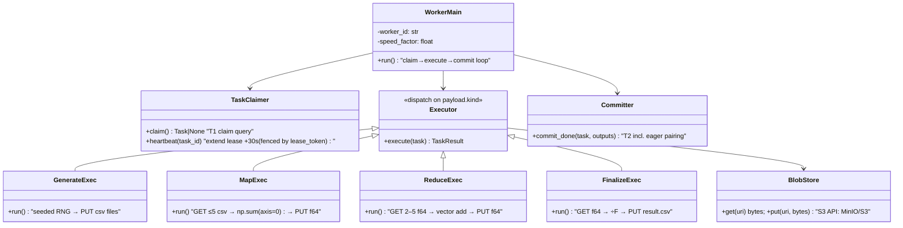

# Distributed Mean — Low-Level Design (v2)

**Date:** 2026-08-10 · **Author:** Samkit Shah · **Status:** v2 — hardened after adversarial review (see `CHANGELOG.md`)
**Reads with:** `02-hld.md` (architecture & rationale) · ITDs for decisions

> v2 blocker fixes: claim query now serves `finalizing` jobs (v1 could never finalize);
> eager pairing serialised per job via advisory lock (closes a mutual-decline race that
> stranded partials); heartbeat fenced by status+token and reaper rotates the token;
> DM-007-consistent priority direction. Plus: result delivery decided (302 pre-signed),
> admission control, API idempotency, absolute task deadline, READ COMMITTED stated.

---

## 1. Database schema (Postgres 16)

```sql
CREATE TYPE job_status  AS ENUM ('pending','running','finalizing','completed','failed');
-- 'finalizing' guards double-finalize: the completion branch of T2 transitions
-- running → finalizing atomically with enqueuing the finalize task (DM-003).
CREATE TYPE task_status AS ENUM ('pending','claimed','done','failed','dead');
CREATE TYPE task_type   AS ENUM ('generate','map','reduce','finalize');

CREATE TABLE jobs (
  id            UUID PRIMARY KEY DEFAULT gen_random_uuid(),
  f             INT  NOT NULL CHECK (f BETWEEN 2 AND 99999),
  c             INT  NOT NULL CHECK (c BETWEEN 2 AND 999999),
  status        job_status NOT NULL DEFAULT 'pending',
  result_uri    TEXT,
  error         TEXT,
  created_at    TIMESTAMPTZ NOT NULL DEFAULT now(),
  completed_at  TIMESTAMPTZ
);

CREATE TABLE tasks (
  id            UUID PRIMARY KEY DEFAULT gen_random_uuid(),
  job_id        UUID NOT NULL REFERENCES jobs(id),
  type          task_type   NOT NULL,
  status        task_status NOT NULL DEFAULT 'pending',
  priority      SMALLINT    NOT NULL,          -- finalize=0 < reduce=1 < map=2 < generate=3
  payload       JSONB       NOT NULL,          -- see §2 (URIs + params only, < 1 KB)
  attempts      SMALLINT    NOT NULL DEFAULT 0,
  max_attempts  SMALLINT    NOT NULL DEFAULT 3,
  worker_id     TEXT,
  lease_token   UUID,                          -- per-claim fencing token (DM-006)
  lease_expires_at TIMESTAMPTZ,
  dedupe_key    TEXT,                          -- natural key for generate-spawned map tasks
                                               -- ('map:{jobId}:{batchIdx}') ONLY. reduce has
                                               -- no natural key: its dedupe comes from the
                                               -- consumed-guard; finalize's from the
                                               -- running→finalizing CAS (DM-006)
  created_at    TIMESTAMPTZ NOT NULL DEFAULT now(),
  finished_at   TIMESTAMPTZ
);
-- The queue index: everything the claim query touches, nothing else.
CREATE INDEX idx_tasks_claim ON tasks (status, priority, created_at) WHERE status = 'pending';
CREATE INDEX idx_tasks_lease ON tasks (lease_expires_at) WHERE status = 'claimed';
CREATE INDEX idx_tasks_job   ON tasks (job_id, status);
CREATE UNIQUE INDEX idx_tasks_dedupe ON tasks (dedupe_key) WHERE dedupe_key IS NOT NULL;

CREATE TABLE partials (
  id            UUID PRIMARY KEY DEFAULT gen_random_uuid(),
  job_id        UUID NOT NULL REFERENCES jobs(id),
  uri           TEXT NOT NULL,                 -- s3://…/partials/{producing_task_id}.f64
  count         INT  NOT NULL,                 -- n: input files covered by this Σ-vector
  produced_by   UUID NOT NULL UNIQUE REFERENCES tasks(id),  -- + ON CONFLICT DO NOTHING:
                                                            -- a redelivered task cannot
                                                            -- insert its partial twice (DM-006)
  consumed_by   UUID REFERENCES tasks(id),     -- NULL = available for pairing
  created_at    TIMESTAMPTZ NOT NULL DEFAULT now()
);
CREATE INDEX idx_partials_avail ON partials (job_id) WHERE consumed_by IS NULL;

CREATE TABLE workers (
  id             TEXT PRIMARY KEY,             -- hostname:pid
  status         TEXT NOT NULL DEFAULT 'idle', -- idle | busy | draining
  current_task   UUID,
  speed_factor   REAL NOT NULL DEFAULT 1.0,    -- demo: artificial slowdown for straggler tests
  last_heartbeat TIMESTAMPTZ NOT NULL DEFAULT now(),
  started_at     TIMESTAMPTZ NOT NULL DEFAULT now()
);

CREATE TABLE system_config (
  key TEXT PRIMARY KEY, value JSONB NOT NULL   -- {'desired_workers': 8}
);

CREATE TABLE events (                          -- append-only, feeds SSE (DM-009)
  id BIGSERIAL PRIMARY KEY,                    -- monotone; doubles as SSE Last-Event-ID cursor
  ts TIMESTAMPTZ NOT NULL DEFAULT now(),
  type TEXT NOT NULL,                          -- taxonomy in DM-009 (job.* streamed; task.* folded into 1 Hz snapshot)
  job_id UUID, task_id UUID, worker_id TEXT,
  payload JSONB NOT NULL DEFAULT '{}'
);
CREATE INDEX ON events (id) INCLUDE (type);
CREATE INDEX ON events (job_id, id);
-- Retention: trim to 7 days / 2M rows; no UPDATE/DELETE otherwise.
```

Invariants (enforced by transactions in §4):

- **INV-1 (conservation):** for a running job, Σ count over unconsumed partials + files covered by in-flight/pending map & reduce tasks = F.
- **INV-2:** a partial is consumed by at most one task, ever (`consumed_by` set once, guarded).
- **INV-3:** a job is `completed` iff a result object exists and exactly one partial with count = F was finalized.

## 2. Task payloads (discriminated union — TS type, mirrored by Python dataclasses)

```ts
type TaskPayload =
  | { kind: 'generate'; jobId: string; fileIdxFrom: number; fileIdxTo: number; c: number; seedBase: string }
  | { kind: 'map';      jobId: string; inputUris: string[] /* ≤5 */; c: number }
  | { kind: 'reduce';   jobId: string; partialIds: string[] /* 2–5 */; partialUris: string[]; c: number }
  | { kind: 'finalize'; jobId: string; partialUri: string; f: number; c: number };
```

## 3. The claim query (queue + fairness in one statement)

```sql
WITH inflight AS (                                   -- fresh per claim: one aggregate,
  SELECT job_id, count(*) AS n                       -- never a per-row correlated subquery
  FROM tasks WHERE status='claimed' GROUP BY job_id
),
candidate AS (
  SELECT t.id
  FROM tasks t
  JOIN jobs j ON j.id = t.job_id
             AND j.status IN ('running','finalizing')  -- v2 FIX: 'running' alone made
                                                       -- finalize tasks unclaimable — no
                                                       -- job could ever complete
  LEFT JOIN inflight i ON i.job_id = t.job_id
  WHERE t.status = 'pending'
  ORDER BY
    COALESCE(i.n, 0),                                -- fairness: least-served job first
    t.priority ASC,                                  -- finalize=0 first … generate=3 last
    t.created_at                                     -- FIFO tiebreak
  LIMIT 1
  FOR UPDATE OF t SKIP LOCKED
)
UPDATE tasks SET status='claimed', worker_id=$1, attempts=attempts+1,
                 lease_token = gen_random_uuid(),
                 lease_expires_at = now() + interval '30 seconds'
WHERE id = (SELECT id FROM candidate)
RETURNING id, type, payload, lease_token;
```

Notes:
- All transactions run at **READ COMMITTED** (Postgres default) — deliberate: every
  guard in T2/T3 is a *conditional write* (`WHERE consumed_by IS NULL`,
  `WHERE lease_token=$mine AND status='claimed'`, `ON CONFLICT DO NOTHING`), which takes
  its row lock at write time; nothing relies on snapshot stability, so no serialization
  retries exist to handle.
- `SKIP LOCKED` gives W concurrent claimers W distinct rows — this *is* the queue
  (DM-004). Contended-head caveat: with `LIMIT 1`, a claimer whose one candidate is
  locked gets zero rows, not the next row; the worker retries once immediately before
  falling back to `IDLE_POLL_MS`. (Alternative if measured: `LIMIT ceil(W/4)` in the
  CTE, update the first survivor.)
- The `inflight` CTE computes per-job counts once per claim (DM-007's own form) — the
  v1 correlated-subquery-in-ORDER-BY form evaluated it per pending row (up to 20k rows)
  and could not use `idx_tasks_claim`.
- Lease = 30 s, heartbeat extends every 10 s, reaper polls every 5 s → worst-case
  crash-detection latency 35 s. Short lease is safe *because* heartbeats extend it.
  Heartbeat SQL is itself fenced (v2 FIX — token alone was insufficient because the
  reaper didn't rotate it):
  `UPDATE tasks SET lease_expires_at = now() + interval '30 seconds'
   WHERE id=$t AND lease_token=$mine AND status='claimed'
     AND lease_expires_at < to_timestamp($claimed_at + TASK_DEADLINE_SECONDS)`
  — the deadline conjunct means a wedged-but-heartbeating worker (hung blob GET behind
  a live heartbeat thread) cannot hold a task past `TASK_DEADLINE_SECONDS` (DM-006).

## 4. The three critical transactions

### T1 — job submission (API)

```
BEGIN;
  -- admission control (v2): reject 413 if F×C×8 > MAX_JOB_BYTES;
  -- 429 + Retry-After if active jobs ≥ MAX_ACTIVE_JOBS
  INSERT INTO jobs (f, c, idempotency_key) VALUES ($f, $c, $key) 
    ON CONFLICT (idempotency_key) DO NOTHING;        -- v2: retried POST returns the
  -- 0 rows → return 200 with the existing jobId     --     original job, never a twin
  -- seed generate tasks in batches of GEN_BATCH=50 files
  INSERT INTO tasks (job_id, type, priority, payload) SELECT … ;  -- ⌈F/50⌉ rows
  UPDATE jobs SET status='running' WHERE id=$jobId;
  INSERT INTO events (type, job_id, payload) VALUES ('job.submitted', …);
COMMIT;
```

Transactional enqueue: job row and its seed tasks are atomic — no half-submitted jobs
(DM-004). (`jobs.idempotency_key TEXT UNIQUE NULL` — nullable; without the header,
duplicate submission creates a distinct job by design, since F and C carry no identity.)

### T2 — task completion + eager pairing (worker; the heart of the system)

Runs after the worker has PUT its output object. All-or-nothing:

```
BEGIN;
  UPDATE tasks SET status='done', finished_at=now()
    WHERE id=$taskId AND status='claimed' AND lease_token=$myToken;  -- fenced commit (DM-006)
  -- 0 rows → lease was reaped & task reassigned (zombie worker) → ROLLBACK, discard.
  -- The PUT already done is harmless: deterministic key, byte-identical content.

  IF task.type IN ('map','reduce'):
    inserted = INSERT INTO partials (job_id, uri, count, produced_by) VALUES (…)
      ON CONFLICT (produced_by) DO NOTHING RETURNING id;   -- idempotent metadata
    -- no row returned → a prior commit of this task already ran pairing → skip it

    -- EAGER PAIRING (DM-003), serialised per job (v2 FIX):
    SELECT pg_advisory_xact_lock(hashtext($jobId::text));
    -- v1 used SKIP LOCKED on partials here. Under READ COMMITTED two concurrent
    -- T2s could then EACH undercount the partial set AND each see the other's task
    -- as still 'claimed' — both decline to pair, and since pairing only runs on
    -- partial commit, the job strands ≥2 partials forever (reachable at F=7, W=2).
    -- The advisory lock serialises the section (milliseconds); the second pairer
    -- sees the first's committed partial and its task row as 'done'.

    SELECT id, uri, count FROM partials
      WHERE job_id=$jobId AND consumed_by IS NULL
      ORDER BY created_at
      FOR UPDATE;                                    -- plain lock; we hold the job lock

    IF ≥ 5 rows                            → take the oldest 5
    ELIF no pending/claimed tasks for job
         AND ≥ 2 rows                      → take all (2–4)     -- drain mode
    ELIF exactly 1 row AND count == F      → CAS: UPDATE jobs SET status='finalizing'
                                                  WHERE id=$jobId AND status='running';
                                             1 row → INSERT finalize task
                                             0 rows → someone finalized already: no-op
    ELSE                                   → nothing (a later commit will pair it —
                                             guaranteed: some task for this job is
                                             still pending/claimed, else a drain or
                                             finalize branch would have fired)

    IF took k rows:
      new_reduce_id = INSERT INTO tasks (type='reduce', priority=1, payload={partialIds, partialUris});
      UPDATE partials SET consumed_by = new_reduce_id WHERE id IN (…);  -- INV-2

  IF task.type = 'finalize':
    UPDATE jobs SET status='completed', result_uri=$uri, completed_at=now()
      WHERE id=$jobId AND status='finalizing';       -- fenced job-state CAS (v2)
COMMIT;
```

Concurrent committers for the *same job* queue on the advisory lock for milliseconds;
committers for different jobs don't interact (the lock is per-job). The ELSE branch is
now provably safe: it is only reachable while other tasks of the job are in flight,
and each of those has its own T2 that re-evaluates pairing.

### T3 — reaper (supervisor, every 5 s)

```
UPDATE tasks SET status = CASE WHEN attempts >= max_attempts THEN 'dead' ELSE 'pending' END,
               worker_id = NULL, lease_expires_at = NULL,
               lease_token = NULL          -- v2 FIX: rotate the fence on requeue so a
                                           -- stale token can never match a future state
 WHERE status='claimed'
   AND (lease_expires_at < now()
        OR now() > claimed_at + TASK_DEADLINE_SECONDS);  -- absolute deadline: reclaims
                                           -- wedged-but-heartbeating holders (DM-006)
-- attempts is incremented at CLAIM time only (T-claim); the CASE above reads the
-- already-incremented value. Incrementing here too would double-count.
UPDATE jobs SET status='failed', error='task exhausted retries: …'
 WHERE id IN (SELECT DISTINCT job_id FROM tasks WHERE status='dead');

-- Backstop sweep (DM-003): jobs in ('running','finalizing') with zero pending/claimed
-- tasks should not exist (T2's advisory-lock pairing always fires completion). If
-- found: log loudly; if a count==F partial exists, enqueue finalize. With the v2
-- advisory lock this is a true bug detector, not a mechanism.
```

## 5. Worker (Python) — structure & loop



```python
def run(self):
    register_worker(self.worker_id)
    while not self.shutdown_requested:          # SIGTERM → drain: finish task, then exit
        task = claimer.claim()                   # one round-trip; None if queue empty
        if task is None:
            idle_sleep(0.5 + jitter())           # bounded poll; LISTEN/NOTIFY evolution noted
            continue
        set_worker(busy, task.id)
        with heartbeat_every(10, task.id):       # background lease extension
            outputs = executor.execute(task)     # pure compute + blob I/O, NO db writes
            committer.commit_done(task, outputs) # T2: single transaction
        set_worker(idle)
```

Execution discipline that makes everything else true:
- **Execute is side-effect-free except deterministic PUTs.** Output keys are
  deterministic functions of the task's *inputs*: partials at
  `jobs/{jobId}/partials/{taskId}.f64` (task-derived), the result at
  `jobs/{jobId}/result.csv` (job-derived — safe because exactly one finalize exists
  per job, guarded by the running→finalizing CAS, with identical input partial and F).
  Any retry writes the same bytes to the same key (idempotency, DM-006).
- **Memory ceiling respected by construction:** map/reduce hold ≤5 × C float64
  (~40 MB at C=1M) + one accumulator (`np.add` in place, 8 MB).
- **Straggler simulation for the demo:** `SPEED_FACTOR` env inserts
  `sleep(work_time × (factor−1))` — lets us demo NFR-2 with 1×/3×/10× workers.

## 6. API surface (Express + TS)

| Method & path | Req | Resp | Notes |
|---|---|---|---|
| `POST /jobs` | `{f, c, inputUris?}` + `Idempotency-Key?` header | `202 {jobId}` \| `413` too large \| `429` too many active | T1. `inputUris[]` (length F) skips generation and seeds `map` directly — exists so the prompt's own F=2 example is a first-class test |
| `GET /jobs` | `?limit=50&cursor=` | `[{id,f,c,status,progress,…}]` | keyset pagination on `(created_at,id)` |
| `GET /jobs/:id` | — | `{status, progress, counts:{pending,claimed,done}, error?}` | progress = coverage (below) |
| `GET /jobs/:id/result` | — | `302` → 15-min pre-signed GET \| `?inline=1` streams \| `409` until `completed` | keeps the API off the data plane (DM-005 owns this decision) |
| `GET /system/stats` | — | `{workers:{desired,alive,busy,idle}, jobs:{queued,running,completed,failed}, tasks:{…}, throughput, oldest_pending_age_sec, oldest_claimed_age_sec}` | UI poll fallback; the two age gauges are the stall SLIs (DM-009) |
| `PATCH /system/workers` | `{desired}` | `200 {desired}` | bonus: writes `system_config`; supervisor reconciles (DM-008) |
| `GET /events` | SSE | `text/event-stream` | tails `events` table (id > Last-Event-ID) (DM-009) |

**API conventions (v2):** request validation with zod at the edge, mirroring the DDL
CHECKs; error bodies `{error:{code,message,details}}`; `400` malformed / `422`
out-of-range / `409` result-not-ready / `413` job too large (`F×C×8 > MAX_JOB_BYTES`) /
`429` too many active jobs (with `Retry-After`). Completion is discovered via the
`job.completed` SSE event or polling `GET /jobs/:id`; webhooks are out of scope (no
authenticated caller to sign to). "Jobs queued" (bonus metric) = running jobs with ≥1
pending task and 0 in flight. Cancellation is out of scope for v1/v2 but designed:
`UPDATE jobs SET status='cancelled'` — the claim query already filters on job status,
so in-flight tasks drain and nothing new is claimed.

**Progress metric (DM-009):**
`(mapped_files + reduce_inputs_consumed) / (F + R_est)`, clamped at 99% until
`finalize` commits (only finalize writes 100%). `mapped_files` = Σ count over
map-produced partials; `reduce_inputs_consumed` = partials with `consumed_by IS NOT
NULL`; `R_est` = ideal-tree input count ≈ F/4, computed at submit. Both numerator terms
are monotone (state-derived, not event-counted, so retries can't double-count).
`done_tasks/total_tasks` is rejected: eager pairing grows the denominator mid-run and
the bar would move backwards.

## 7. Object store layout & file formats

```
bucket: distributed-mean
  jobs/{jobId}/inputs/{fileIdx}.csv          # one float per line ("0.7391824…\n")
  jobs/{jobId}/partials/{taskId}.f64         # raw little-endian float64 × C; metadata: x-amz-meta-count
  jobs/{jobId}/result.csv                    # one float per line, C lines
```

- CSV inputs: human-readable, satisfies "format of your choice", demo-friendly.
- `.f64` partials: 8 MB vs ~20 MB CSV; `np.frombuffer` / Node `DataView` read it with
  zero parsing (DM-005). `count` lives in the partials row (authoritative) and object
  metadata (debug).
- GC: on job completion, `inputs/` and `partials/` deleted async (config-gated so the
  demo can keep them for inspection).

## 8. Configuration

| Var | Default | Meaning |
|---|---|---|
| `K_FANIN` | 5 | the RAM constraint; single source of truth |
| `GEN_BATCH` | 50 | files per generate task |
| `LEASE_SECONDS` / `HEARTBEAT_SECONDS` / `REAPER_SECONDS` | 30 / 10 / 5 | liveness; worst-case crash detection 35 s (DM-006) |
| `TASK_DEADLINE_SECONDS` | 300 | absolute per-task ceiling — heartbeats can't extend past it; reclaims wedged-but-heartbeating workers (DM-006) |
| `MAX_JOB_BYTES` / `MAX_ACTIVE_JOBS` | 50 GB local (5 GB demo) / 8 | admission control; unset on AWS |
| blob client timeouts | connect 5 s, read 30 s, ≤3 retries | a hung GET fails instead of hanging the task |
| `MAX_ATTEMPTS` | 3 | then task dead → job failed |
| `IDLE_POLL_MS` | 500 | worker poll when queue empty |
| `SPEED_FACTOR` | 1.0 | per-worker artificial slowdown (demo) |
| `DESIRED_WORKERS` seed | 4 | initial W; runtime value in `system_config` |

## 9. Local demo topology (docker-compose)

```
services:
  postgres:16    minio    api (node:22)    supervisor (node:22, same image)
  worker:        build: ./worker (python:3.12-slim + numpy)
                 deploy: replicas = W   (supervisor scales via docker API)
  ui:            static site served by api (or nginx)  — SSE client
```

**Runbook (v2):** `make up` (compose up + node-pg-migrate applied by the API on boot +
`mc mb` init container creates the bucket) · `make demo F=1000 C=100000` (~3 min at
W=4, per the service-time model in 01 §4) · `make chaos` (demo + kill a busy worker) ·
`make test`. Why Postgres and not SQLite for a laptop demo: SQLite has no
`SKIP LOCKED`, a single writer, no `LISTEN/NOTIFY`, and RDS is the deployment target —
the demo must exercise the same concurrency the design argues about.

## 10. Test & demo plan (maps to §6 success criteria of 01-requirements)

1. **Correctness:** `pytest` — golden test: F=7,C=10 vs numpy reference (exercises
   F%5≠0 → drain-mode fan-in 2); `test_prompt_example`: F=2,C=3 with `inputUris`
   pointing at [1,2,3] and [4,5,6] → asserts exactly [2.5, 3.5, 4.5]; property test:
   random F,C ≤ 100 vs reference, 1e-9 rel.
2. **Unit:** eager-pairing under concurrent committers with the interleaving *pinned*:
   two explicit DB connections, a `pg_sleep` injected between one committer's partial
   INSERT and its pairing step, asserting the other blocks on the advisory lock and
   then sees the full partial set (INV-1/INV-2 hold; the v1 mutual-decline race stays
   dead).
3. **Chaos demo:** `docker kill` a busy worker → lease expires → task re-claimed →
   job completes; result still exact (idempotent PUT).
4. **Straggler demo:** 3 workers at SPEED_FACTOR 1/3/10; assert fast worker's task
   count ≈ proportional, total idle time ≈ 0 while eligible tasks exist.
5. **Fairness demo:** submit F=5000 job, then F=8 job 5 s later → F=8 completes far
   earlier (claim-order round-robin), both progress concurrently in UI.
```
