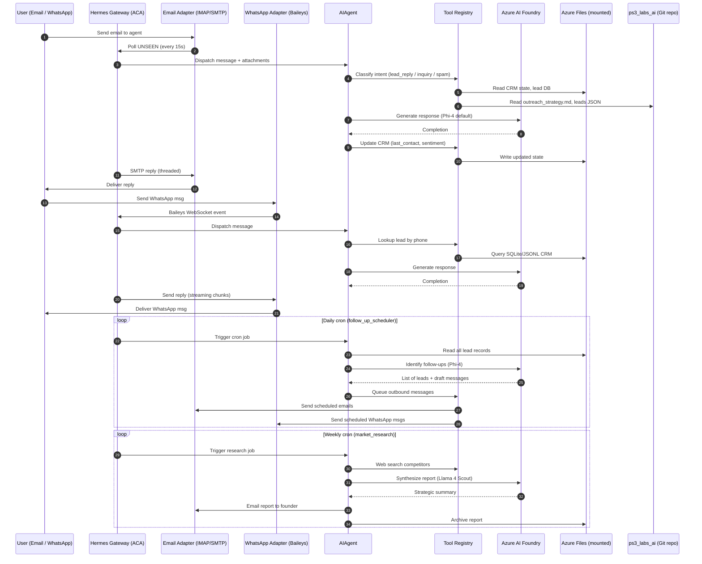

# Design Proposal: Hermes Agent on Azure AI Foundry for PS3Labs Sales & Marketing

## Goal
Deploy a persistent, autonomous Hermes agent on Azure AI Foundry that functions as an always-on marketing and sales operations team for PS3Labs (and future ventures). The agent must handle lead enrichment, outreach drafting, CRM tracking, and multi-channel engagement via Email and WhatsApp, using cheap open-source models to minimize run cost.

---

## Decision Questions & Recommendations

### 1. Which Azure compute for the persistent daemon?
**Options:** Azure VM, Azure Container Apps (ACA), Azure Functions, Azure Kubernetes Service.

**Recommendation: Azure Container Apps (Consumption plan)**
- **Why:** Cheapest persistent compute. ACA Consumption includes a free tier (180k vCPU-sec + 360k GiB-sec + 2M requests/month). A 0.5 vCPU / 1 GiB container running 24/7 costs roughly **$13–18/month** after free tier. Scales to zero is supported but we will pin `minReplicas: 1` because the WhatsApp bridge and email IMAP poll must stay alive.
- **Why not VM:** ~$30–60/month for the smallest B-series. Overkill for a single Python daemon.
- **Why not Functions:** Not suitable for long-running WebSocket connections (WhatsApp Baileys bridge) and continuous IMAP polling.
- **Why not AKS:** Operational overhead and cost unjustified for one container.

### 2. Which LLM on Azure Foundry?
**Constraint:** Open-source (or at least cheap), good quality, available via Azure Foundry Serverless API.

**Recommendation: Tiered model strategy**

| Tier | Model | Role | Est. Cost |
|---|---|---|---|
| **Default / Workhorse** | **Phi-4** (14B dense, Microsoft open-source) | Routine tasks: lead scoring, email replies, data parsing, cron summaries | ~$0.07 / 1M tokens |
| **Heavy / Analysis** | **Llama 4 Scout** (109B MoE, 17B active, Meta open-source) | Complex tasks: pitch deck drafting, competitive analysis, strategic planning, long-context research | ~$0.60 / 1M tokens |
| **Reasoning / Deep Work** | **DeepSeek-R1** (open-source reasoning model) | Multi-step reasoning: pricing strategy, contract analysis, ROI calculations | ~$2.00 / 1M tokens (use sparingly) |

- **Why not Kimi:** Moonshot AI's Kimi models are **not available on Azure Foundry**. They are available via Moonshot's own API (primarily China-focused) and some third-party providers, but not as a first-party Azure offering.
- **Why Phi-4 as default:** It punches above its weight on instruction-following and tool use. At 14B parameters it is fast and extremely cheap. Fine for 80% of sales/marketing tasks.
- **Why Llama 4 Scout as heavy:** 10M context window, very capable reasoning, significantly cheaper than GPT-4o/Claude while being open-source. Good for reading long documents (proposals, lead lists, strategy docs).
- **Cost control:** Set `max_completion_tokens` per-task type. Use Phi-4 for everything unless the prompt explicitly tags `#heavy` or `#reasoning`.

### 3. Authentication to Azure Foundry?
**Options:** API key stored in `.env`, or Microsoft Entra ID ( Managed Identity / keyless ).

**Recommendation: Managed Identity (Entra ID) with ACA System-Assigned Identity**
- **Why:** No secrets in config/git. Azure Container Apps supports System-Assigned Managed Identity out of the box. Assign `Azure AI User` role on the Foundry resource. Hermes' `azure-foundry` provider with `auth_mode: entra_id` auto-discovers the identity.
- **Local dev:** Use `az login` + Azure CLI credential chain. Same config, different auth source.

### 4. WhatsApp: Official Business API or Hermes' Baileys bridge?
**Options:** Meta WhatsApp Business API (requires Meta dev account, Business verification, ~$0.005–0.05/msg), or Hermes' built-in Baileys bridge (unofficial WhatsApp Web, free, small ban risk).

**Recommendation: Hermes Baileys bridge for MVP; migrate to Business API if scale/ban-risk demands**
- **Why:** Zero per-message cost. No Meta Business verification (can take weeks). Works immediately.
- **Mitigating ban risk:** Use a dedicated phone number (Google Voice prepaid SIM, ~$5 one-time). Don't send bulk unsolicited messages. Only reply to inbound or warm leads.
- **Migration path:** If the number gets restricted, switch to a new number or upgrade to Official API. The adapter abstraction in Hermes means the channel config changes but skills logic stays identical.

### 5. Email provider?
**Options:** Gmail (free, app password required), Outlook/Microsoft 365 (app password), SendGrid (API, good for bulk), custom domain.

**Recommendation: Gmail for agent inbox (free) + SendGrid for outbound campaigns (if needed)**
- **Why:** Hermes' email adapter uses raw IMAP/SMTP — it works with any provider. Gmail is free and reliable for a single agent inbox.
- **Outbound volume:** If sending >100 cold emails/day, switch outbound to SendGrid/Amazon SES to protect domain reputation. Hermes can use SendGrid via a custom python tool while keeping Gmail for replies.

### 6. State / memory architecture?
**Options:** Pure filesystem (Hermes default), Azure Blob Storage, Azure Files, PostgreSQL.

**Recommendation: Azure Files mounted to ACA for persistence + Git-based CRM tracker**
- **Why:** Hermes stores sessions, configs, and the WhatsApp Baileys session in `~/.hermes/`. ACA containers are ephemeral — we must mount an Azure Files share to `/root/.hermes` so state survives restarts.
- **CRM data:** The existing `ahmedabad_b2b_leads.json` and future lead databases should live in the Git repo (ps3_labs_ai) so the agent can read/write them and changes are version-controlled. Alternatively, a small SQLite DB on the Azure Files share for operational state (last-contact timestamps, engagement scores).
- **Long-term memory:** Use Hermes' built-in session persistence + disk-based tools. For cross-session business memory, add a custom `crm_memory` tool that appends to a JSONL file on the mounted share.

### 7. How does the agent access PS3Labs data?
**Constraint:** The agent runs in a container but needs to work with files in the `ps3_labs_ai` repo.

**Recommendation: Git + Volume Mount hybrid**
- Mount a read-only clone of `ps3_labs_ai` into the container at `/workspace/ps3_labs_ai` via a CI/CD pipeline or init container.
- The agent reads `ahmedabad_b2b_leads.json`, `outreach_strategy.md`, etc. as context.
- Writes (updated lead status, new outreach sequences) go to the Azure Files share. A nightly cron job inside the container (or a GitHub Action) syncs changes back to the repo.
- **Alternative:** Use a persistentDisk mount directly to the Git working tree. The agent can `git commit && git push` autonomously via an SSH deploy key.

### 8. What does "autonomous marketing and sales team" actually do?
**Recommendation: Define explicit skills/cron jobs**

| Skill / Job | Frequency | Model Tier | Description |
|---|---|---|---|
| `lead_enrichment` | On-demand (or daily cron) | Phi-4 | Read `ahmedabad_b2b_leads.json`, enrich with web research, update scores |
| `outreach_drafter` | On-demand | Phi-4 / Llama 4 | Draft personalized cold emails / WhatsApp messages for top-N leads |
| `crm_updater` | Real-time | Phi-4 | Log every interaction (email sent, reply received, WhatsApp msg) to JSONL/DB |
| `follow_up_scheduler` | Daily cron | Phi-4 | Identify leads needing follow-up, draft reminders, queue messages |
| `market_research` | Weekly cron | Llama 4 Scout | Research competitors, industry news, summarize for strategy docs |
| `inbox_manager` | Real-time | Phi-4 | Read incoming emails, classify (hot lead, junk, partner inquiry), auto-reply or escalate |
| `analytics_reporter` | Weekly cron | Phi-4 | Generate engagement stats: reply rates, best-performing templates, pipeline health |

---

## Architecture Diagram (Mermaid)



---

## Component Design

### Azure Container Apps Job / Service
```yaml
# Conceptual Bicep / ACA YAML properties
properties:
  configuration:
    activeRevisionsMode: Single
    ingress:
      external: false   # No public HTTP needed; outbound-only for Foundry + IMAP/SMTP
  template:
    containers:
      - name: hermes-gateway
        image: <acr>/ps3labs-hermes:latest
        resources:
          cpu: 0.5
          memory: 1Gi
        env:
          - name: HERMES_HOME
            value: /data/.hermes
        volumeMounts:
          - mountPath: /data
            volumeName: hermes-data
    scale:
      minReplicas: 1      # Must stay alive for IMAP poll + WhatsApp WebSocket
      maxReplicas: 1      # Single instance avoids state conflicts
    volumes:
      - name: hermes-data
        storageType: AzureFile
        storageName: ps3labs-hermes-share
```

### Hermes Config (`config.yaml`)
```yaml
model:
  provider: azure-foundry
  base_url: https://<your-resource>.openai.azure.com/openai/v1
  api_mode: chat_completions
  auth_mode: entra_id          # Managed Identity — no API key
  default: phi-4                # Cheap default
  context_length: 16000        # Phi-4 context
  # Fallback / override routing handled by custom tool

gateway:
  platforms:
    email:
      poll_interval: 15
      allowed_users:
        - samkit@ps3labs.ai
        - partner@example.com
    whatsapp:
      mode: bot
      allowed_users: "*"         # Lock down after testing
      unauthorized_dm_behavior: ignore

display:
  tool_progress: new
  busy_ack_enabled: true

cron:
  jobs:
    - name: follow_up_scheduler
      schedule: "0 9 * * *"      # 9 AM daily
      command: "python /app/skills/follow_up.py"
    - name: market_research
      schedule: "0 10 * * 1"     # 10 AM Mondays
      command: "python /app/skills/market_research.py"
```

### Custom Skills (to build)
1. **`crm_toolkit`** — Read/write lead records, update statuses, compute engagement scores.
2. **`outreach_drafter`** — Personalized message generation using lead context + templates.
3. **`lead_enricher`** — Web search + scraping to fill missing fields (company size, tech stack, recent news).
4. **`analytics_reporter`** — Aggregate interaction logs, produce CSV/HTML reports.
5. **`foundry_router`** — Route prompts to Phi-4 vs Llama-4 vs DeepSeek-R1 based on complexity tags.

---

## Design Guards (Invariants)

> These are architectural invariants. Implementation details may vary, but these rules must hold.

1. **No long-lived secrets in container image.** All auth must use Managed Identity (Azure) or runtime environment injection. The image must be publishable to a public registry without leaking credentials.

2. **Single source of truth for leads.** The Git repository (`ps3_labs_ai`) is the canonical lead database. The container may maintain a local cache/SQLite for fast queries, but it must reconcile upstream at least daily. No lead data lives only in a container.

3. **Cost ceiling on inference.** The agent MUST track monthly token spend per model and halt or downgrade to Phi-4 if a configurable budget is exceeded. No runaway Llama-4 bills.

4. **WhatsApp ban resistance.** The agent MUST NOT initiate outbound WhatsApp messages to cold numbers. Outbound WhatsApp is only for replies to inbound messages or for leads who have explicitly opted in via email/other channel. This is a business continuity invariant.

5. **Email sender reputation protection.** Outbound cold email volume MUST NOT exceed 50/day via Gmail SMTP. If volume needs to scale, outbound MUST route through SendGrid/SES with proper DKIM/SPF.

6. **Idempotent CRM writes.** Every CRM update MUST be an append-only log entry or a timestamped upsert. No in-place overwrites that destroy history. Lead state is derived from the log.

7. **Graceful degradation on Foundry outage.** If Azure Foundry returns 5xx or auth errors, the agent MUST queue work locally and retry with exponential backoff. It MUST NOT crash-loop and lose in-flight sessions.

8. **Gateway restart = session resume.** On ACA replica restart (deployment, crash, platform maintenance), the WhatsApp Baileys session and email IMAP state MUST persist via the Azure Files mount. Re-pairing should be a last resort, not a weekly chore.

---

## Cost Estimate (Monthly)

| Line Item | Amount | Notes |
|---|---|---|
| Azure Container Apps (0.5 vCPU, 1 GiB, always-on) | ~$15 | After free tier |
| Azure Files (10 GB share) | ~$1 | Minimal text/JSON state |
| Azure AI Foundry — Phi-4 (workhorse) | ~$5–15 | Depends on volume; ~1M–3M tokens |
| Azure AI Foundry — Llama 4 Scout (heavy tasks) | ~$5–20 | ~500K–2M tokens, gated by router |
| Azure AI Foundry — DeepSeek-R1 (sparing use) | ~$0–10 | Only for complex reasoning jobs |
| WhatsApp number (Google Voice / prepaid) | $0–5 | One-time or minimal |
| Gmail (agent inbox) | $0 | Free tier |
| **Total Estimated** | **$26–66 / month** | Heavily dependent on message volume |

---

## Risks & Mitigations

| Risk | Likelihood | Impact | Mitigation |
|---|---|---|---|
| WhatsApp number banned | Medium | High | Use dedicated number; never cold-outbound; have backup number ready; migration path to Official API documented |
| Azure Foundry rate limit / outage | Low | Medium | Exponential backoff; local queue; fallback to cheaper model tier |
| Runaway API costs | Medium | High | Cost tracker middleware; monthly budget hard cap; per-job max_tokens |
| Hermes gateway crash loses CRM state | Low | High | Azure Files mount for persistence; daily Git sync; append-only logs |
| Gmail SMTP blocked for bulk sending | Medium | Medium | Volume cap at 50/day; SendGrid migration path ready |

---

## Implementation Roadmap

### Phase 1: Infrastructure (Week 1)
1. Provision Azure Container Apps environment + Azure Files share
2. Assign System-Assigned Managed Identity, grant `Azure AI User` on Foundry resource
3. Deploy Llama 4 Scout + Phi-4 on Azure Foundry (serverless)
4. Build Dockerfile with Hermes + Node.js (for WhatsApp bridge) + Python deps
5. Deploy container, verify `hermes doctor` passes, verify Foundry connectivity

### Phase 2: Channels (Week 1–2)
1. Configure Email adapter (dedicated Gmail, app password via ACA secret)
2. Configure WhatsApp adapter (dedicated number, QR scan via `hermes whatsapp`)
3. Test bidirectional messaging on both channels
4. Seed allowlists and pairing codes

### Phase 3: Skills & CRM (Week 2–3)
1. Implement `crm_toolkit` skill — read/write to SQLite on Azure Files
2. Import `ahmedabad_b2b_leads.json` into CRM schema
3. Implement `outreach_drafter` with template system
4. Implement `lead_enricher` (web search + scraping)
5. Implement `foundry_router` for model selection

### Phase 4: Automation (Week 3–4)
1. Set up cron jobs: `follow_up_scheduler`, `market_research`, `analytics_reporter`
2. Build inbound email classifier (hot lead / inquiry / spam / partner)
3. Set up cost tracking and budget alerts
4. Daily/hourly Git sync of CRM changes back to repo

### Phase 5: Hardening (Week 4)
1. Add health probes (`hermes doctor` in liveness check)
2. Set up Azure Monitor alerts for container restarts and cost spikes
3. Disaster recovery: document re-pairing WhatsApp from backup session
4. Security review: rotate secrets, lock down allowlists, review logs

---

## Open Questions (for Founder Decision)

1. **Domain for email:** Should the agent use `sales@ps3labs.ai` (requires setting up custom domain email) or stick with a dedicated Gmail for now?
2. **WhatsApp jurisdiction:** Is the target market India? If so, a VoIP number from India may be harder to obtain. A US Google Voice number works globally for WhatsApp.
3. **Outbound volume expectation:** How many leads do you expect to engage per week? This determines whether SendGrid becomes necessary immediately.
4. **Human-in-the-loop:** Should outbound messages (especially cold emails) require human approval before sending, or full autonomy?
5. **Lead source expansion:** Beyond `ahmedabad_b2b_leads.json`, will you feed the agent new lead lists manually, or should it scrape/self-discover?

---

*Design v1.0 | PS3Labs | 2026-05-28*
